# Back up and restore your library

Use Komikku's normal backup screen to save your library together with Komikku FC ratings, recommendation choices, linked versions, and local reading progress. You choose what to include and what to restore.

## Where you find it

Open **Settings > Data and storage**, then use Komikku's backup or restore actions. Komikku FC data appears inside the supported backup categories rather than through a separate backup screen.

<em>Choose what to include in a backup.</em>

## What Komikku FC adds to a backup

Use the app's normal backup actions to choose a file location or schedule. Alongside library data, a backup can include your ratings, recommendation settings, linked manga versions and preferred versions, plus saved source-quality choices.

Check these options before creating the file:

| Option | What it saves |
| --- | --- |
| Taste profile | Your manga ratings, tag preferences and alternate tag names, disabled recommendation sources, linked versions, preferred versions, saved For You focus modes, source-quality choices, and saved alternate-source pairs and chapter matches. |
| Local tracking | Local reading status, last-read chapter, score, dates, lists, linked source entries, and each version's saved progress and choice about sharing progress. |
| App settings | App preferences, including recommendation controls stored as settings. Select this as well as Taste profile if you want those controls back. |
| Source settings | Settings belonging to your installed configurable sources. |
| Include sensitive settings | Optional private settings, such as tracker sign-in details. This is off by default; leave it off unless you need those details in the backup. |

For a backup of linked reading progress, include **Taste profile** and **Local tracking**, along with the library and chapter data you want to keep. These are separate choices: saving ratings does not automatically save local tracking. A backup does not undo changes on a tracker website or other outside service.

## Restore and check the result

1. Create a fresh backup of your current data before restoring over it.
2. Choose a backup you trust, then select what to restore.
3. Read the completion message and any error report. Some entries may be missing even when the restore finishes.
4. Check your library, ratings, linked and preferred versions, and local chapter progress before retrying anything.

Cancelling stops the remaining work; it does not undo entries already restored. Older backups cannot restore fields they never saved. You may need to reinstall a source extension or sign in again.

## Protect your backup

Keep the backup somewhere you trust. It can reveal your library, ratings, reading preferences, and any sensitive settings you included. Hiding its location in a settings summary does not encrypt the file or make it safe to share publicly.

## Preferred versions after restoring

The preferred version is the copy shown for a linked group. A valid saved choice replaces your current choice only if it is newer, or if you have no choice saved. A tie keeps the current choice. Invalid backup choices can be ignored.

If the preferred version is no longer in the group, the app can show another available member. This does not migrate your manga to another source.

## What a backup does not save

- **Downloaded pages:** copy your download folder separately to keep those files.
- **OCR text:** rebuild recognized text from the downloaded pages when needed.
- **Action History:** temporary Undo entries are not included.
- **Source evaluation:** results and run history are not included, unlike the saved source-quality choices listed above.
- **Outside-service changes:** restoring does not undo tracker updates or reinstall extension packages.

Sign-in details depend on the sensitive-settings option. You may need to sign in again after restoring; do not assume every backup excludes those details.

See [Local tracking](local-tracking.md) for shared chapter progress and [Ratings](ratings.md) for linked groups and preferred versions.
