# Managing extensions

Extensions connect Komikku FC to manga sources. Install only extensions you trust. Installing an extension, trusting it, and choosing a source for recommendations are different actions.

## Where you find it

Open **Browse > Extensions** to install, update, trust, remove, or export extensions. [Sources to Try](sources.md) suggests extensions you do not have yet.

<em>Installed sources in Browse.</em>

<em>Exporting an installed extension.</em>

## Installation and trust

1. Open **Settings > Advanced > Extensions > Extension installer** and choose an offered method.
2. Return to **Browse > Extensions** and choose **Install** or **Update** for an extension you trust.
3. Follow any Android prompt, then check the result in the extension list.

The installer controls how the extension is added. Private installation keeps it inside the app and is not offered in public builds. Other methods can install an Android package or need extra setup. **Shizuku** is a separate helper app that must be installed and set up first; selecting it when it is missing shows a warning and leaves your installer choice unchanged.

Confirmation prompts depend on the method and permissions. A missing prompt does not by itself mean an operation failed.

The installer choice inside **Source evaluation** applies to that evaluation, not this general preference. Changing either installer choice does not install an extension by itself. See [Source evaluation](source-evaluation.md) for its installation and cleanup warnings.

- **Install or update:** get the selected extension using your installer choice. Read permission, trust, and compatibility warnings.
- **Trust:** allow an untrusted installed extension to load. Check its origin first; this is not a safety guarantee.
- **Remove:** remove the extension, not its manga from your library. Its sources may stop loading manga.
- **Export:** save a copy of installed extension files. Check what you are sharing and whether you may distribute it.
- **Evaluate:** check recommendation fit separately. A successful installation does not prove the source is useful or safe.

## If an extension cannot load

Read its trust or compatibility warning in **Browse > Extensions**. Resolve the warning only if you trust the extension, or choose another one. Repeatedly retrying its manga will not fix an incompatible extension. Other extensions may still work. See [Safety](safety.md) and [Troubleshooting](troubleshooting.md).

## Install and remove

Do not assume the requested version was installed just because you pressed its button. Check the result after a cancelled or failed install or update. Supported action-history entries are not a backup of extension files or a guarantee that every package action can be undone.

## Exported-file cleanup

Choose installed extensions to export, then choose a destination in Android's document picker. Check the result before sharing the file:

| Result | What happens next |
| --- | --- |
| Cancel before choosing a destination | No export file is created by this action. |
| Export succeeds | Public builds keep the completed file. |
| Incomplete file identified after failure or cancellation | If offered, choose **Keep** or **Remove** for that file only. |
| File or result cannot be identified reliably | The app cannot safely offer Remove. Check the file yourself. |

Export copies an already-installed extension file without modifying or re-signing it. A multiple-extension archive also includes extension names, versions, package identifiers, signatures, and repository information. It does not contain your library or tracker account data. Name hiding does not hide these details inside the export.

Development builds can offer removal of a completed export for testing; this is never automatic deletion. Cleanup targets only the file created by this export. A failed removal leaves it in place. See [Sharing](sharing.md) for more about cleanup and cancellation.

## Continue to Source evaluation

Sources to Try does not install a suggestion until you choose to do so. A suggestion is not a guarantee about its content, availability, or quality. After a successful installation, review its sources and choose [Source evaluation](source-evaluation.md) separately to check recommendation fit.

Keep your extension list private unless you intend to share it: names and repositories can identify your reading setup.
