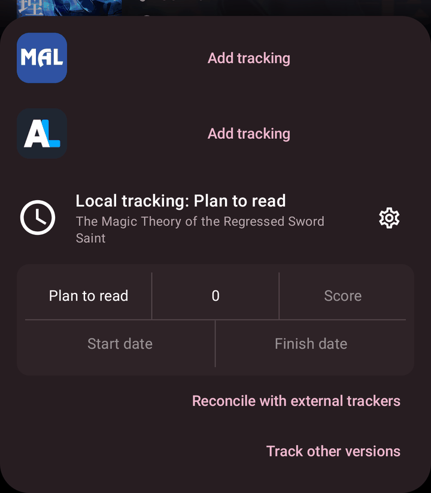
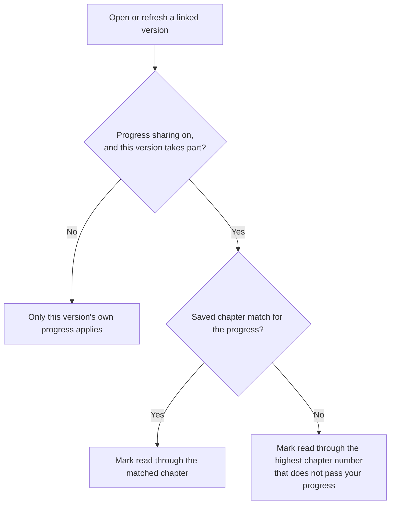
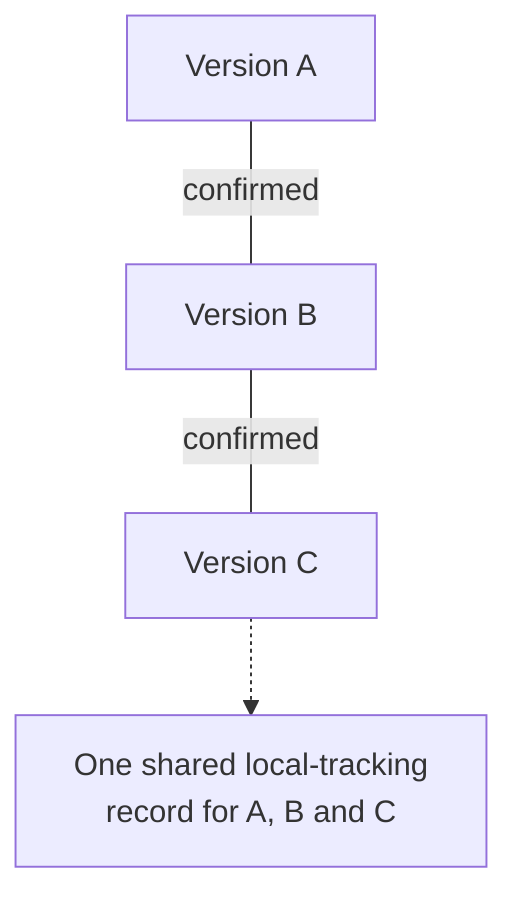
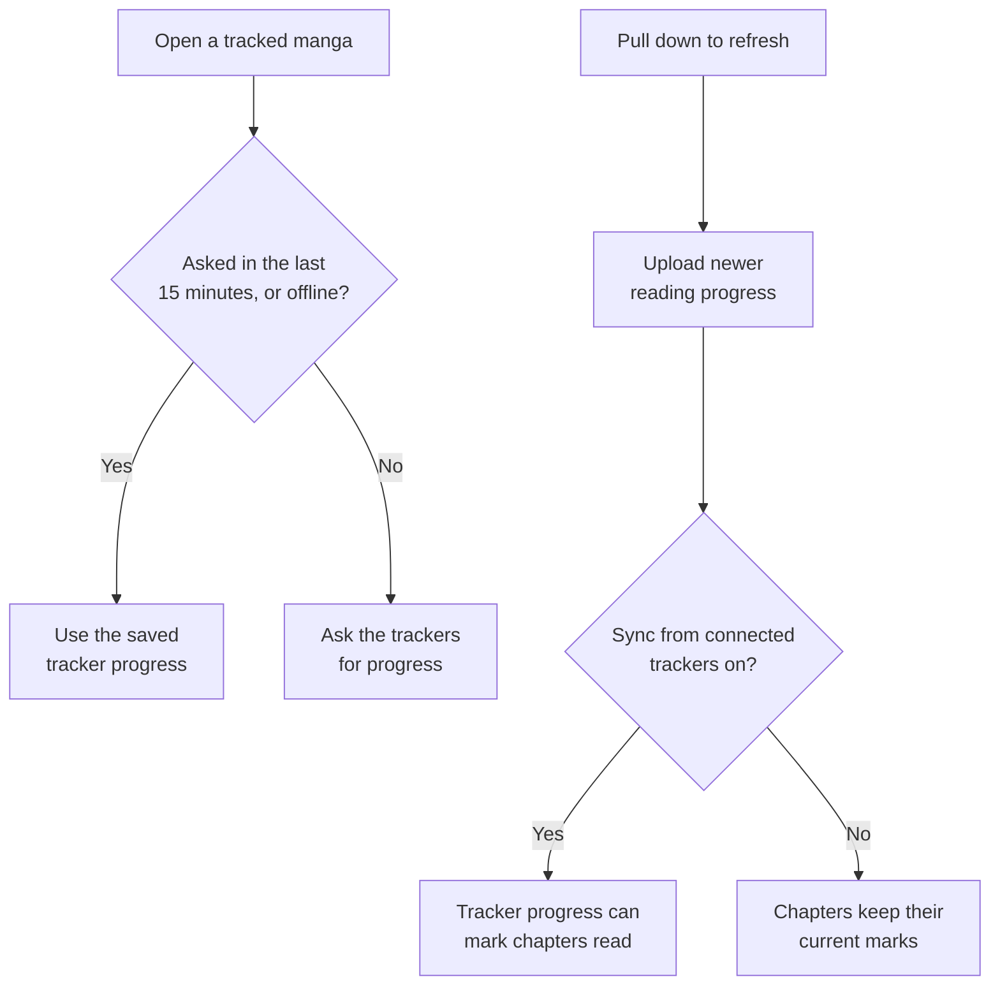
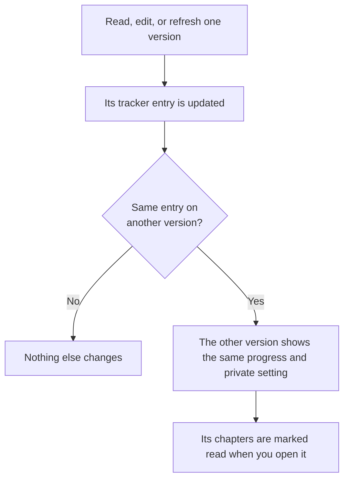

# Local tracking

Local tracking remembers your reading status and chapter progress in Komikku FC. You do not need a MyAnimeList, AniList, or other tracking account.

## Open your progress

1. Open a manga and select **Trackers**.
2. Find its **Local tracking** entry. If it has no entry yet, rating the manga can start one when **Start tracking when you rate a manga** is enabled.
3. Select the reading status, chapter number, score, or date to change it.

<em>The Local tracking entry in the tracking sheet. Select the title to see confirmed versions.</em>

The chapter picker lets you scroll to a chapter. You can also enter a number, including zero or a decimal such as `4.1`.

## Keep another source caught up

A linked version is the same manga from another source that you have confirmed belongs with this one. It is not an app version or software update.

When you open or refresh a manga, the app applies its saved local progress to the chapters available for that version. This also works when checking connected external trackers is turned off.

With **Share progress across linked versions** enabled, participating confirmed versions can also catch up with progress recorded on another version. For example, if you read through chapter 15 on one source, opening or refreshing a linked version can mark its chapters through the matching point as read. This does not send an update to an outside tracker account.

If there is no saved chapter match between the sources, the app uses the highest available chapter number that does not exceed your saved progress. With progress at 15 and a list containing chapters 14 and 16 but no 15, it can mark through 14, not 16. Recognized decimal chapters such as 4.1 are included, and multiple translations with the same number can all be marked read through that point.

A chapter match you previously confirmed takes priority over comparing numbers. If two sources use different numbering, the matched chapter can therefore have a different number. Unnumbered chapters need an identifiable chapter match; the app cannot reliably guess their place from the title alone. No matching available chapter means there may be nothing to mark yet.

Sources sometimes number chapters differently or offer several translations of the same chapter. Check the selected chapter when switching sources rather than assuming every source uses the same numbers.

When switching sources, the chapter chooser selects the first available chapter with the same number. If there is no exact match, it selects the closest available number; equally close numbers favor the lower chapter. Several translations can share a number. The translation group's name appears when the source supplies it, so you can choose another entry before opening it. The automatic choice is not a judgment of translation quality.

### Versions linked through another version

Versions you confirmed as the same manga through another version share one local-tracking record. For example, if you confirmed A = B and B = C, then A, B, and C share one record even though you never confirmed A = C directly. Opening or refreshing any of them gathers its already-linked versions, so progress does not wait for you to open one particular version.

When local tracking starts, it begins at the chapter you read most recently on any linked version. If chapters are marked read further than that on any linked version, it starts there instead. Chapters can be marked read by hand, from a backup, or from a tracker.

### Stop sharing with one version

1. Select the manga title in its **Local tracking** entry to open **Confirmed versions**, which lists its confirmed linked versions. Selecting a version there opens its full manga page. **Track other versions**, below the entry, is a separate search for more versions.
2. Find the version you want to keep separate.
3. Clear **Keep reading progress in sync** for that version. Select it again to rejoin progress sharing.

<em>Confirmed versions, each with Keep reading progress in sync.</em>

This changes progress sharing for that version, not your rating, whether the manga is in your library, or an external tracker account.

## Change automatic behavior

Open **Settings > Tracking**, or select the settings icon beside the local tracker.

| Setting | What it changes |
| --- | --- |
| Open track menu on adding to library | Opens the tracker menu after adding a manga when you have a connected tracker account. Opening the menu does not by itself select an external match. |
| Update progress after reading | Sends chapters you read to connected tracking services. This is off by default and separate from local progress sharing. |
| Update progress when marked as read | Chooses Always, Ask, or Never for sending newer progress when you manually mark chapters read. With Ask, accept the update message to send it; dismissing the message leaves that update unsent. |
| Start tracking when you rate a manga | Creates local tracking when you rate a manga, so you do not need to start it separately. |
| Share progress across linked versions | Keeps participating, confirmed copies of the same manga caught up with local progress. |
| Update local progress from trackers | Uses a higher chapter reported by a connected tracker to bring local progress forward. |
| Sync reading progress from connected trackers | Checks connected trackers for newer progress when you refresh a tracked manga. |
| Match progress when chapter numbers differ | Uses reading order when importing tracker progress from a source whose numbering starts later. Turn it off to compare chapter numbers only. |
| Select entries using source metadata | When adding an external tracker, tries the tracker link supplied by the manga source before opening title search. If that match cannot be registered, title search still opens. This does not confirm links between local manga versions. |

**Match progress when chapter numbers differ** applies to importing external-tracker progress. It first tries chapter numbers. Reading order is a fallback for whole-number progress when the source's main chapters start above 1 and are consecutive through that position. It does not automatically convert every numbering difference between linked local versions.

Local tracking and external tracker accounts are separate. Sending chapters you read to a connected service is controlled by **Update progress after reading**; sharing local progress does not enable that setting for you.

### Refreshing and opening a tracked manga

Pulling down to refresh a tracked manga always uploads your newer reading progress to connected trackers, even with **Sync reading progress from connected trackers** off. That setting still decides whether the tracker's progress marks your chapters as read. Queued uploads that the tracker already has are dropped instead of being sent again.

Opening a manga asks your trackers for its progress at most once every 15 minutes, and not at all while you are offline. Going back and forth between pages therefore does not repeat the requests, and an offline device does not show a tracker error for each tracker. Pull down to refresh to ask straight away.

### Versions that share a tracker entry

When two versions of a manga are tracked on the same external tracker entry, they share that tracker record. Reading one version, changing it in the tracking sheet, or refreshing it updates the other's tracker progress straight away. Making the entry private or public from one version applies to the other versions too, so a later change from another version does not undo it.

Only the tracker record is shared. No extra tracker requests are made, and no chapters are marked read on other sources until you open them. With **Track linked versions together** on, linking a tracker entry to one version also links it to the other confirmed versions that do not have one yet.

When you add an external tracker, your reading progress and, when there is one, your start date are sent in a single request.

**Update progress when marked as read** is a separate choice for manual read marking. It applies when a connected tracker is available and the selected chapters are farther ahead than saved tracker progress. Marking chapters unread does not send a lower chapter through this action.

### Connect an external tracker

In **Settings > Tracking**, select a service to sign in. Some services open their sign-in page in your browser; others show a login dialog. When the source-provided tracker link is unavailable or cannot be registered, choose the matching manga in title search when adding ordinary external tracking. Signing in does not turn on **Update progress after reading**.

The enhanced-services section lists integrations tied to compatible manga sources. Missing-source information means the matching source is not installed, not that your local tracker needs an account. Local tracking continues without signing in to any of these services.

Applying local progress marks chapters read; it does not make later chapters unread or create missing pages. If you mark an earlier chapter unread but leave the tracker farther ahead, the next load or refresh can mark it read again. Check the saved tracker progress when you want to move your reading position back.

## When progress looks wrong

- Confirm the manga versions are actually linked, not merely similar search results.
- Check that progress sharing is enabled and that this version participates.
- Refresh the manga so its chapter list is available.
- If chapter numbers differ, inspect the chapter list and choose the correct chapter yourself.
- If a source fails to load, retry when it is available; a tracker cannot create missing chapter content.

See [ratings and linked versions](ratings.md), [comparing versions](versions.md), and [backups](backups.md) for related actions.
