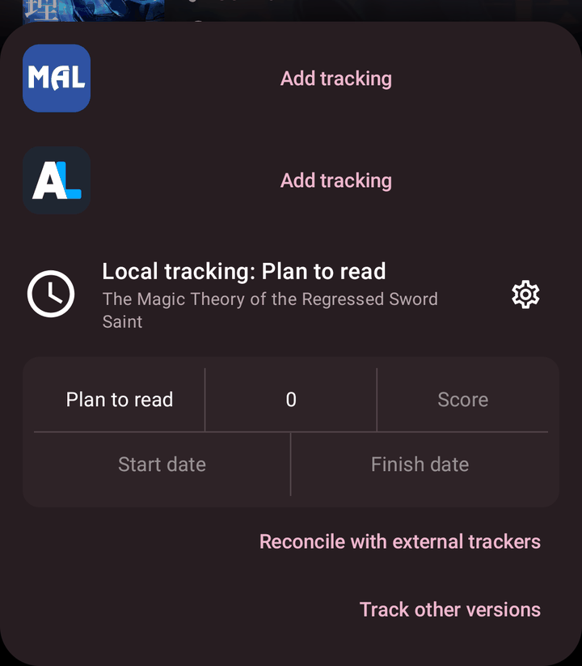
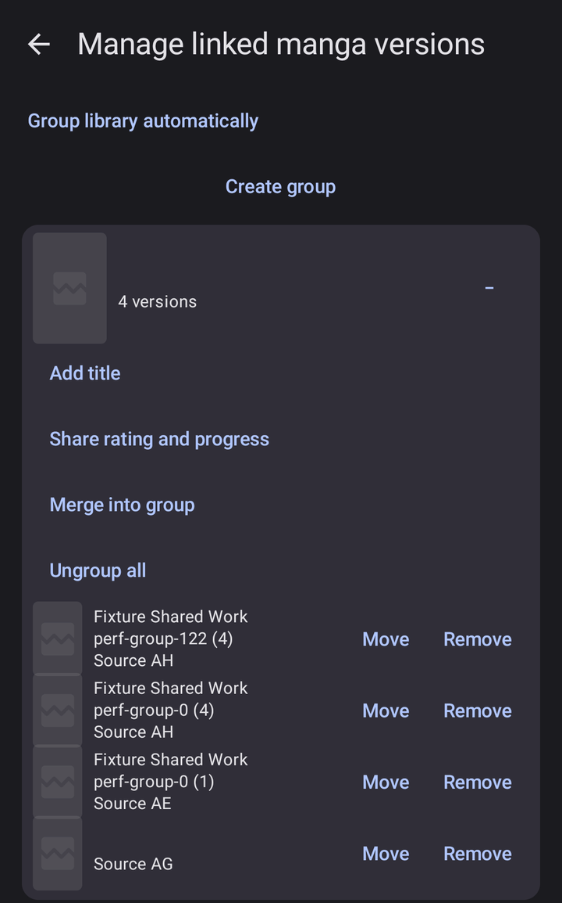
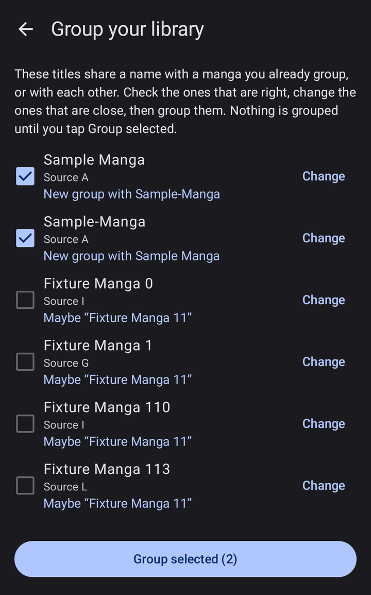
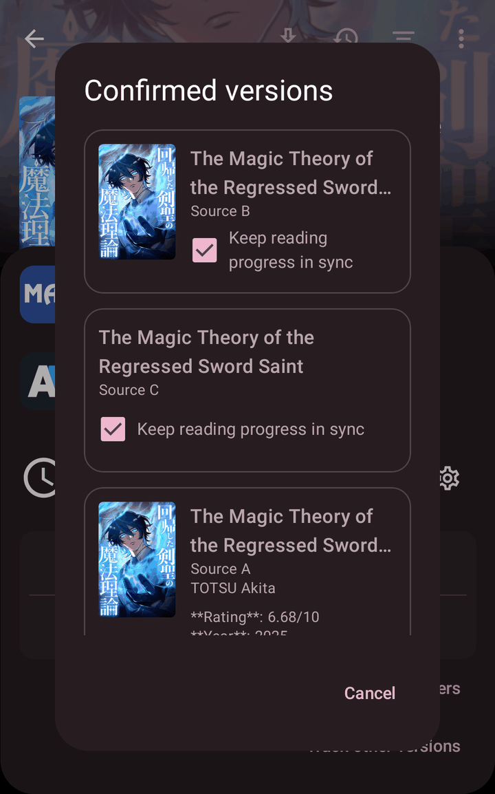

# Local tracking

Local tracking remembers your reading status and chapter progress in Komikku FC. You do not need a MyAnimeList, AniList, or other tracking account.

## Open your progress

1. Open a manga and select **Trackers**.
2. Find its **Local tracking** entry. If it has no entry yet, rating the manga can start one when **Start tracking when you rate a manga** is enabled.
3. Select the reading status, chapter number, score, or date to change it.

<em>The Local tracking entry in the tracking sheet. Select the title to see confirmed versions.</em>

The chapter picker lets you scroll to a chapter. You can also enter a number, including zero or a decimal such as `4.1`.

## Keep another source caught up

A linked version is the same manga from another source that you have confirmed belongs with this one. It is not an app version or software update.

When you open or refresh a manga, the app applies its saved local progress to the chapters available for that version. This also works when checking connected external trackers is turned off.

With **Share progress across linked versions** enabled, participating confirmed versions can also catch up with progress recorded on another version. For example, if you read through chapter 15 on one source, opening or refreshing a linked version can mark its chapters through the matching point as read. This does not send an update to an outside tracker account.

The app first looks for an available chapter match you confirmed. If there is no match, or its chapter is missing from this source, it uses the highest available chapter number at or below your saved progress.

For example:

- Saved progress is 15, but the source has 14 and 16: mark through 14, not 16.
- Saved progress is 126, but the source ends at 110: mark available chapters through 110 and keep shared progress at 126.

Recognized decimal numbers such as 4.1 count too. Multiple translations with the same number can all be marked read through that point.

A chapter match you previously confirmed takes priority over comparing numbers. If two sources use different numbering, the matched chapter can therefore have a different number. Unnumbered chapters need an identifiable chapter match; the app cannot reliably guess their place from the title alone. No matching available chapter means there may be nothing to mark yet.

Sources sometimes number chapters differently or offer several translations of the same chapter. Check the selected chapter when switching sources rather than assuming every source uses the same numbers.

When switching sources, the chapter chooser selects the first available chapter with the same number. If there is no exact match, it selects the closest available number; equally close numbers favor the lower chapter. Several translations can share a number. The translation group's name appears when the source supplies it, so you can choose another entry before opening it. The automatic choice is not a judgment of translation quality.

### Versions linked through another version

Versions you confirmed as the same manga through another version share one local-tracking record. For example, if you confirmed A = B and B = C, then A, B, and C share one record even though you never confirmed A = C directly. Opening or refreshing any of them gathers its already-linked versions, so progress does not wait for you to open one particular version.

When local tracking starts, it begins at the chapter you read most recently on any linked version. If chapters are marked read further than that on any linked version, it starts there instead. Chapters can be marked read by hand, from a backup, or from a tracker.

### When you add another version

**In v0.8.25 (not yet released):** choosing **Track other versions** on a manga screen, adding a title to a group, creating a group, or merging titles into a group gives every version what the group already has, without opening each one. All of this happens on your device and sends nothing to a tracker account:

- The versions are confirmed as the same manga and join the same local-tracking record.
- A version without a rating of its own takes the group's most recent rating, including the manga you are on. A version you rated yourself keeps its rating. **Rate linked versions together** turns this off.
- A tracker entry linked to one version is linked to the others that have none, when **Track linked versions together** is on.
- The chapter you read furthest is applied to every version that already has a chapter list. A version you never opened has no chapter list yet, so the app loads it in the background and the chapter appears a moment later. This uses the version's source, so it needs a connection.

Opening a manga, using **Track other versions** and refreshing a tracker update only that manga's own record, not every tracked manga in your library. A library update and a restore refresh every group once.

Copying a chapter from another version never changes a status you chose. **On hold** and **Dropped** stay set; only you change them, or reading on this device.

After a library update, the app also refreshes the tracker of each linked group once when **Sync reading progress from connected trackers** is on, so progress made on any version reaches the others without opening them.

**In v0.8.25 (not yet released):** when the manga you are on is not in a group yet, **Track other versions** first shows **Already in your groups**: the groups you have with this title or one of its other names, the way Group library automatically matches them. **Add here** adds the manga to that group at once, with the group's rating and progress, and the versions you pick below then join the same group instead of starting a new one. A title you marked **Not the same manga** as one in that group is not added, and the screen says so.

### Manage groups you already have

On a rated list (Loved, Liked, Disliked, Not interested), the link icon opens **Manage linked manga versions**.

- **Share rating and progress**, in a group card's menu, does the same for a group you made before v0.8.25: it confirms the group's versions as the same manga and gives the ones that lack them the rating, tracking, chapter progress and tracker entry.
- In an open group card the **Primary** version comes first and is marked; it gives the group its title and cover here, on the rated lists and in **Move** and **Merge into group**. Any other title's menu has **Set as primary**, which **Undo** can reverse.
- A group card's menu holds **Add title**, **Share rating and progress**, **Merge into group** and **Ungroup all**. Open the card to see its titles; each title has its own menu with **Move** and **Remove**. **Move** and **Merge into group** list the other groups with their cover and number of versions; choose one and the button says what happens.
- If you marked two titles **Not the same manga**, grouping never overrules it. Adding, moving or merging them asks first: **Confirm same manga** if they are the same after all, **Keep apart** if not, and nothing is linked until you choose. **Share rating and progress** stops for that group until you resolve the mismatch; it does not share with only part of the group.
- If a title is linked but its rating and progress were not shared, for example because a source did not answer, the screen says so and offers **Retry**.
- **Remove**, **Move**, **Ungroup all** and **Undo** take back the "same manga" confirmation that grouping made. A confirmation you made yourself, or a decision you changed since, is kept.
- Removing a version gives it a separate local tracker with its saved progress, rating, dates and lists. Moving it first separates it from the old group, then joins it to the new one. **Undo** brings the groups back together using their current progress, including reading done since removal. Already-read chapters and copied ratings remain. A linked external tracker entry also remains: if two versions still point to the same entry on that service, that service's progress is still shared.

If an action fails, check which titles are still in the group before retrying. If the group looks right but progress has not caught up, choose **Share rating and progress**.

<em>Manage linked manga versions, with a group card open.</em>

- **Group library automatically** lists the library titles that are not in a group yet next to the group they most likely belong to. A match is by name first, ignoring capitals, punctuation and accents, then by any other name used by a member of a group, then by close names, which are left unchecked for you to decide. **Change** opens a searchable list of groups, with a choice to leave a title alone. Nothing is grouped until you choose **Group selected**. It only looks at titles in your library.

<em>Group your library: exact matches are checked, close ones are left for you.</em>

### Stop sharing with one version

1. Select the manga title in its **Local tracking** entry to open **Confirmed versions**, which lists its confirmed linked versions. Selecting a version there opens its full manga page. **Track other versions**, below the entry, is a separate search for more versions.
2. Find the version you want to keep separate.
3. Clear **Keep reading progress in sync** for that version. Select it again to rejoin progress sharing.

<em>Confirmed versions, each with Keep reading progress in sync.</em>

This changes progress sharing for that version, not your rating, whether the manga is in your library, or an external tracker account.

## Change automatic behavior

Open **Settings > Tracking**, or select the settings icon beside the local tracker.

| Setting | What it changes |
| --- | --- |
| Open track menu on adding to library | Opens the tracker menu after adding a manga when you have a connected tracker account. Opening the menu does not by itself select an external match. |
| Update progress after reading | Sends chapters you read to connected tracking services. This is off by default and separate from local progress sharing. |
| Update progress when marked as read | Chooses Always, Ask, or Never for sending newer progress when you manually mark chapters read. With Ask, accept the update message to send it; dismissing the message leaves that update unsent. |
| Start tracking when you rate a manga | Creates local tracking when you rate a manga, so you do not need to start it separately. |
| Share progress across linked versions | Keeps participating, confirmed copies of the same manga caught up with local progress. |
| Update local progress from trackers | Uses a higher chapter reported by a connected tracker to bring local progress forward. |
| Sync reading progress from connected trackers | Uses connected trackers' newer progress to mark chapters read, and enables automatic tracker checks when you open a manga. Manual refresh can still upload with this off. |
| Match progress when chapter numbers differ | Uses reading order when importing tracker progress from a source whose numbering starts later. Turn it off to compare chapter numbers only. |
| Select entries using source metadata | When adding an external tracker, tries the tracker link supplied by the manga source before opening title search. If that match cannot be registered, title search still opens. This does not confirm links between local manga versions. |

**Match progress when chapter numbers differ** applies to importing external-tracker progress. It first tries chapter numbers. Reading order is a fallback for whole-number progress when the source's main chapters start above 1 and are consecutive through that position. It does not automatically convert every numbering difference between linked local versions.

Local tracking and external tracker accounts are separate. Sending chapters you read to a connected service is controlled by **Update progress after reading**; sharing local progress does not enable that setting for you.

### Refreshing and opening a tracked manga

Pulling down to refresh a tracked manga always tries to upload newer reading progress, even with **Sync reading progress from connected trackers** off. Connection or tracker errors can still prevent an upload. The setting decides whether the tracker's progress marks local chapters read. Queued uploads that the tracker already has are dropped instead of being sent again.

With that setting on, opening a manga asks its trackers for progress at most once every 15 minutes in the current app session, and skips the automatic check while offline. Going back and forth between pages does not repeat those requests. Pull down to request an update straight away; manual refresh is not suppressed by that interval or the offline check.

Local tracking still applies saved local progress when external syncing is off or an automatic network check is skipped.

### Versions that share a tracker entry

Two versions using the same external tracker entry share its saved record in Komikku FC. When reading, a tracker edit, or a refresh updates that record, the other version's tracker entry follows. Uploads still depend on the relevant settings and a successful tracker request. Changing the entry's private/public setting is shared too.

Mirroring that external tracker record makes no extra network requests. By itself it does not mark another source's chapters read; that happens when you open the manga and apply progress. Local progress sharing, described above, is a separate path.

With **Track linked versions together** on, adding a tracker entry also links it to confirmed versions that do not have one yet.

When you add an external tracker, your reading progress and, when there is one, your start date are sent in a single request.

**Update progress when marked as read** is a separate choice for manual read marking. It applies when a connected tracker is available and the selected chapters are farther ahead than saved tracker progress. Marking chapters unread does not send a lower chapter through this action.

### Connect an external tracker

In **Settings > Tracking**, select a service to sign in. Some services open their sign-in page in your browser; others show a login dialog. When the source-provided tracker link is unavailable or cannot be registered, choose the matching manga in title search when adding ordinary external tracking. Signing in does not turn on **Update progress after reading**.

The enhanced-services section lists integrations tied to compatible manga sources. Missing-source information means the matching source is not installed, not that your local tracker needs an account. Local tracking continues without signing in to any of these services.

Applying local progress marks chapters read; it does not make later chapters unread or create missing pages. If you mark an earlier chapter unread but leave the tracker farther ahead, the next load or refresh can mark it read again. Check the saved tracker progress when you want to move your reading position back.

## When progress looks wrong

- Confirm the manga versions are actually linked, not merely similar search results.
- Check that progress sharing is enabled and that this version participates.
- Refresh the manga so its chapter list is available.
- If chapter numbers differ, inspect the chapter list and choose the correct chapter yourself.
- If a source fails to load, retry when it is available; a tracker cannot create missing chapter content.

See [ratings and linked versions](ratings.md), [comparing versions](versions.md), and [backups](backups.md) for related actions.
