# Search text in downloaded pages

**OCR Search Downloads** reads text from downloaded pages belonging to manga in your library and saves it for searching on your device. Use it to find a phrase inside a page, not just a manga title. OCR means recognizing text in an image; it can misread words or miss them entirely.

## Where you find it

Open **More > OCR Search Downloads**. The search screen lets you process all downloaded manga, choose a page limit, search recognized text, and clear saved search text.

<em>Search text in downloaded pages.</em>

## What OCR Search Downloads is for

First process your downloads, then enter the words you want to find. Processing can take time, storage, and battery. The current text reader uses Latin-script recognition, so do not expect reliable results for every language, unusual lettering, or low-quality image.

Only downloaded pages for manga currently in your library are processed. Downloads belonging to manga outside the library are not included in the all-download action. This feature does not fetch every remote chapter or upload your page images for recognition. A page with no recognized text cannot provide a search match, even if the image contains words you can see.

## Choose how much to process

Indexing means reading the page images and saving their recognized text for search. Choose the action you need:

- **Index all downloaded manga:** process missing pages and retry empty or failed results. Unchanged pages with usable text already saved are skipped.
- **Force re-index all:** process successful pages again too, within your chosen page limit.

Both actions ask for confirmation before starting.

Choose **Unlimited**, 50, 100, 250, or 500 pages. The limit applies to the downloaded pages considered before already-successful pages are skipped, not just new recognition attempts. It is not a per-manga allowance. Repeating a limited run does not necessarily advance to the next set of pages; increase the limit or choose Unlimited to include more downloads. A limited or cancelled run can leave some downloads unprocessed.

## Work, cancellation, and results

Processing runs in the background because a large download library can take time and battery. Cancelling stops further work; it does not mean processing finished. Successfully saved search text remains usable after a partial run. You can run processing again or clear that text.

Search puts stronger word matches above partial matches. Select a result to open the reader at its saved manga, chapter, and page. If the manga, chapter, or downloaded page has changed or disappeared, opening it can fail. Check your downloads and process the downloaded pages again rather than assuming the old result still points to an available page. Ordinary reader use can update reading progress.

## Before sharing a result

Result cards can show recognized page text, manga and chapter titles, source names, and page numbers. These can reveal what you read. Name hiding can hide supported source labels, but not manga titles or recognized text. Inspect the whole screenshot before sharing it; see [Sharing](sharing.md).

## Entry and indexing

1. Open **More > OCR Search Downloads**.
2. Choose a page limit. For a short first run, use 50.
3. Choose **Index all downloaded manga**, or **Force re-index all** to replace previously recognized text too.
4. Read the warning and confirm. Watch the progress on screen or in the notification.
5. Use **Cancel indexing** if you want to stop. Already saved text remains searchable.

Leaving the screen does not itself cancel the background run. Android can still stop work; do not assume every download was processed just because you left it running.

## Page processing

Only recognized text can supply a search match. An empty or failed result does not prove the page has no words. Inspect its image and consider the recognition limits before retrying a large run.

## Search and navigation

Stronger word matches appear higher in the results. A result is a saved reference, not a guarantee that its page is still available.

## Privacy and cleanup

The search index is the saved text, not the downloaded page images. You can clear:

- One chapter or manga from an OCR result's menu.
- Empty or failed entries.
- Entries made by an older OCR version, when that option appears.
- All recognized text with **Clear OCR index**.

These actions do not delete your downloaded pages. You can recognize the text again later.

Removing a manga from your library does not automatically clear its saved OCR text. Use the chapter or manga cleanup action when you want to remove it. **Clear database** also removes OCR entries for non-library manga it deletes, and restoring library entries cleans up OCR entries that no longer match a manga or chapter. Neither action deletes the downloaded page files through OCR cleanup.

Recognized text stays on the device and is excluded from Komikku FC backup and sync. The recognition SDK can still send technical usage information; see [Privacy and data](../privacy-and-data.md#ocr-and-google-ml-kit).
