# How Komikku FC features work together

Komikku FC is an independent Android manga reader based on Komikku. It keeps the familiar library, reader, downloads, and backups, and adds tools for recommendations, linked manga versions, local tracking, page-text search, and optional reading limits.

## Choose the guide you need

- [Recommendations](recommendations.md): find manga based on your preferences.
- [Recommendation settings](recommendation-settings.md): change filters and recommendation choices.
- [Ratings](ratings.md): rate manga and manage linked versions.
- [Local tracking](local-tracking.md): remember chapter progress without a tracker account.
- [Versions](versions.md): compare the same manga from different sources.
- [Reading](reading.md): use reader controls and switch between sources.
- [Source evaluation](source-evaluation.md): check source fit and search compatibility, by hand or on a schedule.
- [Sources](sources.md) and [Extensions](extensions.md): find and manage places to read.
- [Page-text search](ocr.md): search text extracted from manga pages.
- [Backups](backups.md): save and restore supported app data.
- [Sharing](sharing.md), [Safety](safety.md), and [Troubleshooting](troubleshooting.md): review privacy, permissions, and problems.

## Start with your manga

An extension connects the app to a manga source. That source supplies its own titles, chapter lists, and pages. What is available can differ between sources, and a source can be temporarily unavailable.

Browse or search a source, open a manga, then choose a chapter to read. Add it to your library if you want to keep it there; adding it is not required just to read it.

## Ratings and progress are different

A rating tells the app what you think of a manga. Tracking remembers your chapter progress. For You can use both ratings and recent reading to suggest manga; the recent-reading setting decides whether that extra signal is used.

Settings can start local tracking when you rate a manga, or share ratings and progress across confirmed versions. Those remain separate choices. Linking versions is not a copy of all library data; external tracker linking has its own setting. See [Local tracking](local-tracking.md) and [Ratings](ratings.md).

## Compare before changing versions

Different sources can offer different translations, chapter numbering, or image quality. Comparing previews or opening a candidate in the reader does not automatically migrate your library entry. Read the confirmation choices before copying or migrating data.

Keep your current version if you prefer it. To change versions, choose the other one and review the copy or migration confirmation. Opening **View in Reader** can update ordinary reading progress; Back does not undo that reading. See [Versions](versions.md).

## Save data before making large changes

A backup contains the data selected in the backup options, not every file or account detail on your device. Downloaded chapter images need separate handling. Restoring is not an undo button for everything you have done, including changes on external services.

Save the backup somewhere you can access later and trust. See [Backups](backups.md) for sensitive-data options and what a restore keeps or replaces. Before installing an update, read its release notes and use the correct build for your installed app. If the app cannot find the update, follow the [manual update instructions](../release-notes.md).

## Know what is shared

Recommendations do not require a separate Komikku FC recommendation account. That does not make all app activity offline: installed sources receive requests for manga and pages, connected trackers can receive updates, and exports or backups can contain personal reading information.

- **Saved on your device:** settings, ratings, reading history, and local progress.
- **Network activity:** requests to manga sources and connected trackers; some SDKs and optional services also use the network. See [Privacy and data](../privacy-and-data.md).
- **Files you save:** exports and backups can contain reading preferences or account information, depending on their options. Check their contents before sharing.

**Name hiding** replaces supported identifying labels on screen only. It does not hide manga titles or artwork, sanitize exported files, or change the source an action uses. Check screenshots and files yourself before sharing them.

## Read What's New

The in-app **What's New** history explains Komikku FC feature changes separately from Komikku's upstream release information. Open older sections when you want to review previous changes. Reading or acknowledging the history is not the same as downloading or installing an update.

<em>What's New for v0.8.24.</em>

