# Reading and chapter navigation

Read chapters, switch between sources, manage optional reading times, and find your last-read position.

Jump to [timer and schedule basics](#what-changes-and-what-stays-familiar), [reader settings](#page-layout-and-controls), [completion ratings](#completion-and-rating-behavior), [last-read position](#jump-to-last-read), or [switching sources](#switch-between-sources).

## Where you find it

- **Timer:** open the timer action inside the reader.
- **Schedule:** open it from the timer dialog or **Settings > Reader > Reading schedule**. Turn it on to apply your chosen times.
- **Completion rating:** configure **Recommendation Settings > Linked versions and ratings**. An eligible rating offer appears after you leave the reader.
- **Jump to last read:** look in the manga toolbar when a valid reading position exists in the displayed chapter list.

## What changes and what stays familiar

These controls are optional. When disabled, they do not restrict ordinary reading. Dismissing a timer or schedule message does not change chapter progress or bypass an active restriction.

The schedule entry in the reader opens the same choices found under **Settings > Reader**, so there is only one place to manage the schedule. Changes are saved with the app's other settings.

**Reading schedule** lets you choose days and time windows, then either block reading during those windows or allow reading only during them. Enable the schedule to apply it. It affects this app's reader only, not other apps. If an allowed period ends while you are already reading, you can finish that chapter; a new chapter waits until reading is allowed again.

The **manual timer** is separate from the schedule. It counts active reading time rather than time spent with the app in the background. The timer dialog has three sections:

- **How long**: pick a preset or a custom number of minutes.
- **Warn me before time is up**: choose the warnings.
- **When time is up**: choose **Let me finish the current chapter**, and optionally **Allow one extra chapter after that**.

These choices apply from the moment you start the timer. The extra allowance, when enabled, is for one next chapter reached by normal forward reading, not arbitrary chapter-list jumps. A timer allowance does not override a schedule restriction.

## Page layout and controls

Open **Settings > Reader** to change the default reading mode and its controls. Paged, Webtoon, and Vertical+ sections have their own options; changing a Webtoon gesture does not change the paged reader's gesture setting. Some options are unavailable until a related setting is enabled.

Expand the reference when you want to look up a particular control.

Reader settings reference

| Setting | What it changes |
| --- | --- |
| Double tap animation speed | Chooses how quickly the view moves when you zoom with a double tap. It does not make pages download faster. |
| Show reading mode | Briefly shows the current reading mode when you open the reader. |
| Show tap zones overlay | Briefly shows the areas you can tap for navigation when you open the reader. It does not change the tap layout itself. |
| Smaller tap zones | Makes the navigation areas smaller in supported tap layouts, leaving more room for opening the reader menu. It does not resize the manga page. |
| Force horizontal seekbar | Uses the horizontal page-position bar instead of the vertical bar. The vertical-bar placement options are unavailable while this is enabled. |
| Show vertical seekbar in landscape | Allows the vertical page-position bar when the screen is sideways, unless the horizontal bar is forced. |
| Left-handed vertical seekbar | Places the vertical page-position bar on the other side. This does not reverse the chapter's reading direction. |
| Wide images zoom mode | Chooses how the paged reader's automatic wide-image zoom works: fit the image height or use double the starting scale. Enable wide-image zoom with a compatible image scale setting first. |
| Disable zoom in | Limits zooming in within the paged reader. Its Double tap to zoom option is unavailable while this is enabled. Webtoon has separate gesture controls. |
| Smart scale on wide screen | In the Webtoon reader, choose Fit screen or a target page proportion. On a wide display, a target proportion can narrow the reading area; it does not stretch the artwork or improve the original image resolution. |
| Apply Smart scale to Long strip with gaps | Allows that scaling choice in the continuous vertical mode with gaps as well. It is off by default. |
| Pinch to zoom | Enables or disables two-finger zoom in the Webtoon reader. Double tap to zoom is a separate choice. |

For other reader adjustments, use the relevant section:

- **Display** controls rotation, background, fullscreen, keeping the screen awake, and the page number.
- **E-Ink** controls page-change flashes and their duration, interval, and color. These are display choices, not image-quality improvements.
- **Reading** controls skipping already-read, filtered, or duplicate chapters and showing chapter transitions.
- **Paged** and **Webtoon** control tap layouts, page scaling, border cropping, zoom, page transitions, and handling wide or double pages. Splitting double pages and rotating them to fit are alternative choices; enabling either turns the other off.
- **Vertical+** controls page-sized tap scrolling and border cropping for that mode.
- **Navigation** controls volume-key navigation and its direction. **Actions** controls long-press actions and separate manga folders for saved images.
- **Page downloading** controls preloading, simultaneous page downloads, and cache size. These can affect data use and storage; they cannot repair an unavailable source.

Check the page and navigation behavior after changing a setting. A zoom or scaling choice does not replace comparing the actual pages from different sources; see [Versions](versions.md).

### Display

Under **Settings > Reader > Display**, choose how the reader uses your screen:

| Setting | What it changes |
| --- | --- |
| Default rotation | Chooses the reader's starting screen orientation. |
| Background color | Chooses the area behind the pages: black, gray, white, or automatic. It does not recolor the artwork. |
| Fullscreen | Hides the system bars while reading. |
| Show content in cutout area | Allows fullscreen content in the screen area around a camera cutout. This choice is available only on a screen with a cutout while Fullscreen is enabled. |
| Keep screen on | Keeps the display awake while the reader is open. |
| Show page number | Shows your page position while reading. |

### E-Ink

These settings are intended to reduce lingering images on an E-Ink display. They do not improve the source's page resolution.

| Setting | What it changes |
| --- | --- |
| Flash on page change | Enables brief screen flashes as you move through pages. Turn this off if you do not want flashes. |
| Flash duration | Chooses how long a flash lasts. It is available when page-change flashes are enabled. |
| Flash every | Chooses how many page changes occur between flashes. It is available when page-change flashes are enabled. |
| Flash with | Chooses a black, white, or white-then-black flash. It is available when page-change flashes are enabled. |

### Moving between chapters

Under **Settings > Reader > Reading**, choose which chapters ordinary next/previous navigation passes over. Skipping is not the same as marking a chapter read.

| Setting | What it changes |
| --- | --- |
| Skip chapters marked read | Passes over chapters already marked read when moving between chapters. |
| Skip filtered chapters | Passes over chapters excluded by the manga's chapter filters. |
| Skip duplicate chapters | Passes over another entry with the same chapter number, such as a second translation. Matching numbers do not guarantee identical contents. |
| Always show chapter transition | Shows the between-chapter transition even when the adjacent chapter's pages are already loaded. |

### Paged

These choices apply to the paged reader, which moves between individual pages rather than a continuous strip.

| Setting | What it changes |
| --- | --- |
| Tap zones | Chooses where to tap for the previous or next page, or disables tap navigation. |
| Invert tap zones | Reverses the horizontal, vertical, or both tap directions. This choice is unavailable when tap navigation is disabled. |
| Scale type | Chooses how an image fits the available reading area. This changes its displayed size, not the original image. |
| Zoom start position | Chooses which part of a zoomed page is shown first. |
| Crop borders | Removes surrounding borders from the displayed page. It does not edit the source image. |
| Animate page transitions | Enables animation when moving between pages. |
| Automatically zoom into wide images | Starts wide images zoomed in when the chosen Scale type supports this. Wide images zoom mode chooses the starting zoom. |
| Double tap to zoom | Allows zooming with a double tap unless Disable zoom in is enabled. |
| Pan wide images | Uses navigation to move across an image wider than the visible area before changing pages. It is unavailable when tap navigation is disabled. |
| Split wide pages | Shows the halves of a wide page separately. Enabling this turns off Rotate wide pages to fit. |
| Invert split page placement | Reverses which half appears first. It is available while Split wide pages is enabled. |
| Rotate wide pages to fit | Rotates wide pages to fit the display. Enabling this turns off Split wide pages. |
| Flip orientation of rotated wide pages | Changes the direction of the rotation. It is available while Rotate wide pages to fit is enabled. |

### Webtoon

These choices apply to the continuous Webtoon reader. Its settings are separate from the Paged choices above.

| Setting | What it changes |
| --- | --- |
| Tap zones | Chooses where to tap to move through the strip, or disables tap navigation. |
| Invert tap zones | Reverses the selected tap directions. It is unavailable when tap navigation is disabled. |
| Side padding | Adds space along the sides of the strip, reducing the width available for pages. |
| Sensitivity for hiding menu on scroll | Chooses how much scrolling hides the reader menu. Higher sensitivity needs less movement. |
| Crop borders | Crops surrounding borders when displaying pages in this mode. |
| Split wide pages | Displays the halves of wide pages separately. Enabling it turns off Rotate wide pages to fit in this mode. |
| Invert split page placement | Reverses the order of those halves. It is available while splitting is enabled. |
| Rotate wide pages to fit | Rotates wide pages instead of splitting them. Enabling it turns off Split wide pages in this mode. |
| Flip orientation of rotated wide pages | Changes the rotation direction while Rotate wide pages to fit is enabled. |
| Double tap to zoom | Enables zooming with a double tap; Pinch to zoom is a separate choice. |
| Disable zoom out | Prevents shrinking the view below its normal starting scale. It does not turn off zooming in. |
| Animate page transitions | Enables animated movement when navigating through the strip. |

The Smart scale and Pinch to zoom choices are described in the first table. Check the result on an actual page; these settings cannot add detail missing from the source image.

### Vertical+

| Setting | What it changes |
| --- | --- |
| Tap scroll by page | Uses the page size instead of the screen size for tap scrolling in this mode. |
| Crop borders | Crops surrounding borders in the continuous vertical reader. This is separate from the Paged and Webtoon crop settings. |

### Navigation and actions

| Section and setting | What it changes |
| --- | --- |
| Navigation > Volume keys | Allows the volume buttons to move through the reader. |
| Navigation > Invert volume keys | Reverses the buttons' navigation directions. It is available when Volume keys is enabled. |
| Actions > Show actions on long tap | Opens page actions when you press and hold a page. |
| Actions > Save pages into separate folders | Places saved page images in folders named after their manga. This concerns saved images, not downloaded chapter organization. |

### Loading and storage

Under **Settings > Reader > Page downloading**, choose how much the reader loads ahead:

| Setting | What it changes |
| --- | --- |
| Preload amount | Loads nearby pages ahead of your reading position. Larger amounts use more data and temporary storage; they do not guarantee that every page will be ready. |
| Download threads | Chooses how many page downloads can run together. More simultaneous requests can encounter a source's limits. The reader always uses at least one downloader; choosing 0 does not turn downloading off. |
| Reader cache size | Sets the space available for temporary reader images. This is not a chapter-download backup; cached pages can be removed and need loading again. |
| Aggressively load pages | Queues the entire chapter for loading instead of only loading around your current page. It can use data for pages you never reach. |

These choices cannot repair missing pages or an unavailable source. Use ordinary chapter downloads when you want to keep chapters for offline reading.

### Other reader options

The additional reader-options section under **Settings > Reader** contains these choices.

| Setting | What it changes |
| --- | --- |
| Skip queue on retry | Prioritizes retrying the current failed page. It does not retry every failed page immediately or guarantee success. |
| Preserve reading position on read entries | Keeps the saved page position when reopening a chapter already marked read, instead of treating it as a fresh reread. An explicitly requested page still takes priority. |
| Auto Webtoon Mode | Chooses a suitable default mode for manga detected as long-strip format. A reading mode you set for that manga takes priority. |
| Reader Bottom Buttons | Chooses which supported buttons appear along the reader's bottom controls. Hiding a button does not disable its feature. |
| Page layout | Chooses single pages, paired pages, or automatic layout. Splitting double-page images is a different setting and can prevent paired-page display. |
| Invert double pages | Swaps the paired-page ordering where supported. This option is unavailable with single-page layout and does not apply while double-page splitting is enabled. |
| Center margin | Adds space at the center of the selected wide or paired-page layouts, useful when the display has a hinge or an area you want to leave clear. It does not add pages to the chapter. |
| Archive reader mode | Chooses how pages inside chapter archives such as CBZ or CBR are loaded: directly from the file, through memory, or through a temporary disk cache. Memory and storage limits can cause the reader to use a fallback; the chapter contents are not changed. |

## Completion and rating behavior

Under **Recommendation Settings > Linked versions and ratings**, **Ask for a rating after finishing** controls the completion offer. **Ask about other versions** controls the later offer to rate other versions after saving a rating. Neither setting chooses a rating for you.

<em>The rating offer after finishing the latest chapter.</em>

The offer is for an unrated manga after reaching the end of its latest available chapter, in a regular reader session that is not schedule-blocked or using an active alternate-source pair. Reading that chapter again can still qualify if the manga remains unrated.

1. Leave the reader after that completion. The offer does not cover the final page while you are reading.
2. Choose a rating, or **Not now**/Back to leave without changing one. Love, Like, Dislike, and Not interested are available.
3. After saving, **Ask about other versions** can offer to find versions to rate, even without a confirmed group. Review and select those versions if you accept. Dismissing this later offer keeps your first rating and does not rate other versions.

## Jump to last read

On manga with long chapter lists, **Jump to last read** scrolls to your saved reading position. It does not mark chapters read, change progress, or open the reader. If there is no saved position, or your current chapter filter hides it, the action is unavailable rather than jumping to an unrelated chapter.

## Switch between sources

An alternate source is another source offering the same manga. The **primary source** here means the one you started reading from, not the version of the app. Switching sources does not automatically add the other manga to your library.

### Choose when it is offered

Open **Settings > Reader > Alternate sources**. The section explains how reading from another source works and has two switches, both on by default:

| Setting | When the button appears |
| --- | --- |
| Offer when chapters are missing | Chapters are skipped between this chapter and the next. |
| Offer when this source has no next chapter | You reach the last chapter this source has. |

<em>The Alternate sources section in Reader settings.</em>

When either applies, **Continue from another source** appears at the end of the chapter, with a one-line note that you can come back from the top bar. The first time you use it, a short explanation, **Read from another source?**, says that you pick the source and the chapter and that **Return to primary source** in the top bar brings you back. Choose **Continue** to go on, or **Not now** to stay where you are.

### Switch to another source

1. Open the reader's alternate-source chooser and select an available manga. If the app asks whether it is the same manga, check the title and confirm only when it is correct. The chooser first shows the source you are currently reading from. Use **Search more sources** to look in more of your sources, or **Search another title** if the manga is listed under a different name. Pressing Back in that search returns you to the reader.
2. In **Choose the matching chapter**, review the suggested chapter. The first chapter with the same number is selected when available. Otherwise, the closest available number is suggested; if two are equally close, the lower number wins. For example, if you are on chapter 5 and the other source has only 4 and 6, it suggests 4.
3. Check the chapter name and translation-group label when supplied by the source. Several translations may have the same chapter number. You can select a different entry, then choose **Read this chapter**, or **Stay on this source** to cancel.
4. While you read from the other source, **Return to primary source** in the top bar brings you back. While that source pair is active, use **Switch source** in the reader to choose a chapter from the other source. After returning to the primary source, the same action lets you switch back to the alternate source; returning is not the end of the pair.

The suggested chapter number is not a guarantee that the contents match. Some sources split chapters or start numbering at a different point. If the app warns that the match is uncertain, check the pages before continuing. **Correct chapter mapping** lets you change which chapters correspond; **This chapter is not the match** keeps the current chapter open while you choose another match. If you have read ahead and the other source lacks that chapter, choose a suitable chapter from its list instead.

This shortcut depends on an active reading pair and available chapters. If the session ends or cannot be restored, open the alternate-source chooser again rather than expecting the old pair to remain available. Reading-time restrictions still apply when switching sources. See [Versions](versions.md) for comparing page quality and choosing a preferred version, and [Local tracking](local-tracking.md) for sharing progress across linked manga.

## Chapter reading sequence

If a page does not load, check its error message. Opening an alternate source is a separate choice, not an automatic replacement for every failed page.

## Completion preference

The prompt appears after leaving the reader, not over the final page. Declining the offer does not change your rating; selecting a rating does.

## Reading schedule

| Situation | What happens |
| --- | --- |
| Schedule is off, or reading is allowed | Open and read normally. |
| You open the reader while restricted | Reading is blocked immediately. Wait until reading is allowed, then reopen it. |
| A restriction begins while you are already reading | You may finish the current chapter, but cannot start another while restricted. |

Switching sources does not bypass a schedule restriction. The schedule is off by default; the manual timer has its own separate choices.

## Switching a source pair

**Switch source** opens the other source's chapter list while a pair is active. Review the suggested number and translation-group label, then choose **Read this chapter** or **Stay on this source**. You can switch back the same way. If the pages do not correspond, correct the chapter match rather than trusting the number alone.
