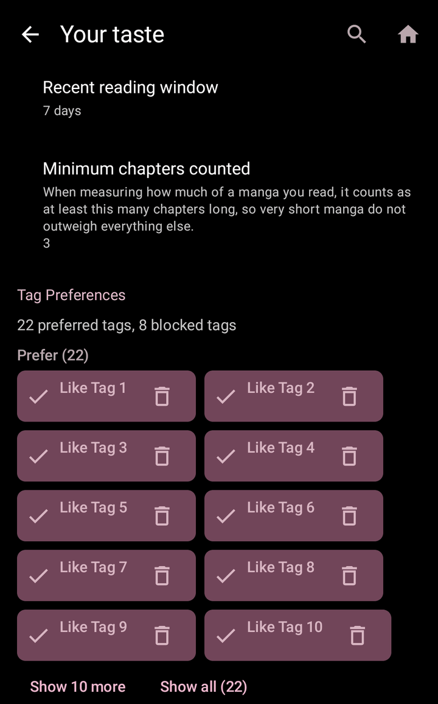
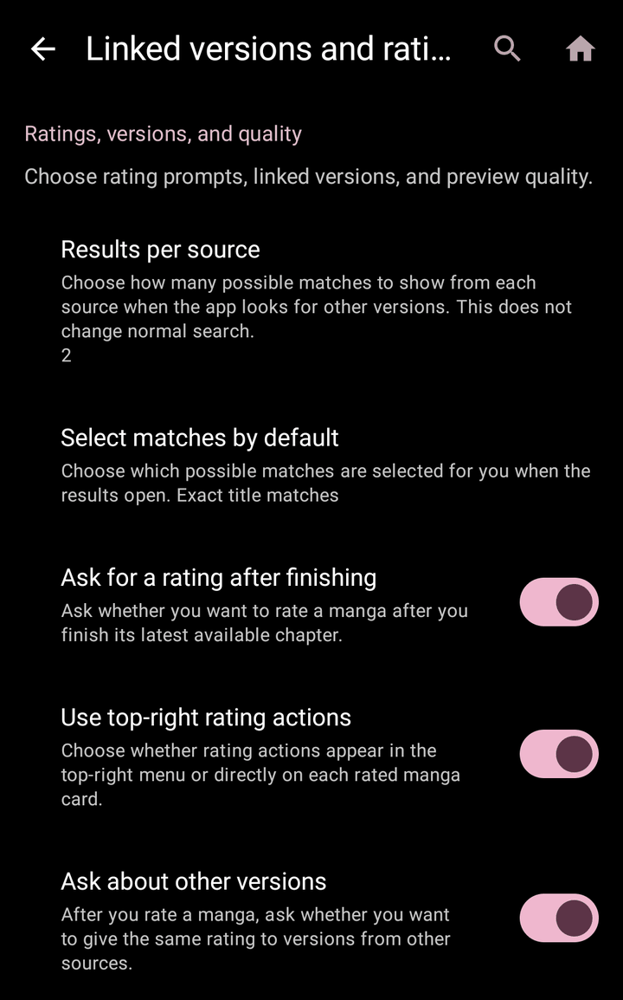
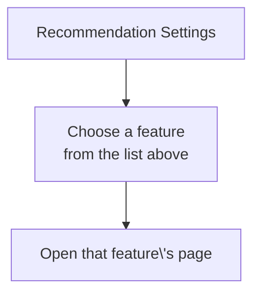
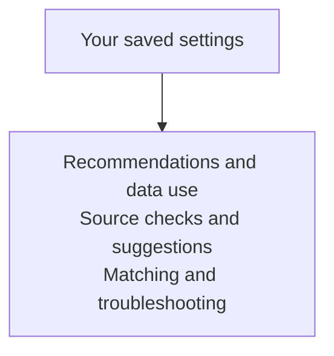
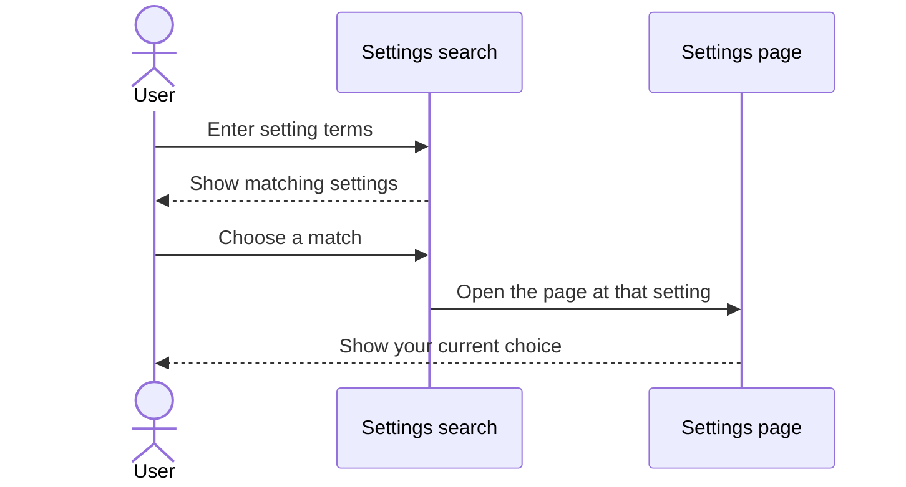
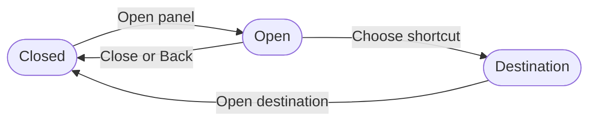

# Configuring personalized recommendations

Recommendation Settings uses the same lists, switches, search, and navigation as the rest of Komikku's Settings.

## Where you find it

Open **Settings > Recommendation Settings**, or open For You and select its settings action. The first page lists one entry per feature, and each row shows that feature's current value:

| Entry | What it covers |
| --- | --- |
| Your taste | Ratings and manga you already know, minimum chapter count, recent reading, preferred and blocked tags, taste suggestions, and recommendation languages. |
| For You feed | Showing the For You tab, looser matches, the For You preview, new-release exploration, repeat display, and source order. |
| Focus modes | Saved Focus modes used by For You's Focus control. |
| Find new sources | [Source evaluation](source-evaluation.md), [suggested sources to install](sources.md), and the automatic source check. |
| Source evaluation | The [Source evaluation](source-evaluation.md) page itself, without going through Find new sources first. |
| Speed and data | Data saving, result limits, extra details, extra pages, and discovery history. |
| Linked versions and ratings | Rating prompts, tracking linked versions together, same-manga matching, and Best Version previews. |
| Troubleshooting | Source loading problems, sources skipped by the automatic check, taste diagnostics, and source tag quality. |

<em>The first page lists one entry per feature, each with its current value.</em>

On a phone, choose an entry to open its page, then press Back to return to the list. On a wider screen, the list stays on the left and the chosen page opens beside it. In both layouts, the row for the page you are on keeps a filled icon. **Source evaluation** can also be opened from the For You menu.

## How the settings are organized

Each page groups related controls under short headings. Settings search finds a setting by its name or summary and opens the page that contains it. Longer explanations appear beside the control when they are useful.

Number settings are checked before the app uses them. A stored value outside a setting's range is replaced by its default or adjusted to the allowed range, depending on the setting; it is not passed to the recommendation features unchanged.

## Your taste

### Choose how much there is to read

Set **Minimum chapter count** to a number from 0 to 50. **0** means **Off**, which is the default, so there is no minimum. Choosing 1 to 50 hides manga with a known count below your choice. This changes recommendations, not your library or saved reading progress.

<em>Your taste: known manga, minimum chapter count, and recent reading.</em>

A newly discovered manga's chapter count is usually unknown until its chapter list has been loaded. After For You shows its rows, it loads the chapter lists of up to 20 shown titles whose count is unknown, a few at a time. It removes titles below your minimum and remembers each count for two weeks, so later refreshes can filter those titles straight away. Only titles whose count could not be checked yet remain unfiltered. The check does not run while For You is saving data.

The setting does not guarantee that every suggested manga has the requested number of chapters. Lower the number or turn it off if too few results remain.

### Use recent reading

**Use recent reading** is on by default. For You then gives more weight to the tags of manga you read within the chosen window, from 1 to 30 days (7 by default). Your ratings still count, but recent reading counts more. Blocked and disliked tags are never boosted, and titles you rated Dislike or Not interested are ignored.

**Minimum chapters counted** (1 to 50, 3 by default) treats a manga as at least that many chapters long when measuring how much of it you read. This setting stops one chapter of a short manga from counting as much as a long reading session. It is separate from **Minimum chapter count**, which filters recommendations.

### Control familiar manga and tags

Under **Ratings and known manga**, choose whether to hide disliked manga, hide all rated manga, or show all rated manga. **Hide manga you already know** is a separate switch: it excludes manga you have rated, added to your library, or started reading, including titles remembered from earlier refreshes that you rated, added, or read since then. Showing rated manga does not override that separate switch.

<em>Preferred and blocked tags. Name hiding replaces tag names with placeholders.</em>

Add a genre or tag as **Preferred** to favor matching manga, or as **Blocked** to exclude matches. You can edit or delete your saved choices. Taste suggestions come from your rated manga, and a suggestion is saved as preferred or blocked only when you choose that action. A suggestion is not a setting already applied for you.

**Languages for recommendations** chooses the languages For You can search. Sources to Try also uses them for its suggestions.

## For You feed

| Setting | What it changes |
| --- | --- |
| Show For You tab | Shows or hides the For You tab in Browse. While it is hidden, your settings are kept and apply again when you show it. |
| Show looser matches | When a source returns manga but none of them match your taste, its row can show up to four of them instead of being empty. These rows are labelled "Looser matches: its tags don't match your taste". Blocked tags, dislikes, and ratings still apply, and looser matches never enter Top Picks. It is on by default. |
| Preview For You | Shows the saved recommendation snapshot. It is not a live source check. |
| Explore new releases | Sets how much For You looks beyond your usual source order for newer manga, from Off to a percentage of its searches. |
| Wait before showing a title again | Moves titles you were recently shown later in the list for the chosen number of days. **Clear repeat history** forgets what was shown. |
| Source order | Enable or disable each source for recommendations and arrange their priority. You can reset the order, or apply a suggested order based on source fit when that action is offered. |

<em>For You feed: looser matches, the preview, new-release exploration, and repeat display.</em>

<em>Each source row shows one-line tags. Boosted is outlined because it is your own choice.</em>

Each source row shows one-line tags for its current state. **Boosted** is outlined because it is your own choice, while tags such as **Great fit** and **Top Picks** describe results. The number beside **Great fit** describes the source's earlier contribution to Top Picks, not how many manga must appear now. The **Shown** count describes the latest refresh after filters and duplicate handling.

## Focus modes

Saved **Focus modes** can be renamed, deleted, and moved up or down here. They are the same modes used by For You's Focus control, not a separate set of settings. Deleting a saved mode does not delete manga from your library. See [Recommendations](recommendations.md#focus-on-what-you-want-now) for choosing tags in Focus.

<em>Saved Focus modes are listed here once you save one from For You.</em>

## Find new sources

This page contains three things:

- **Source evaluation** checks how well each installed source works with For You. See [Source evaluation](source-evaluation.md).
- **Suggested for you** opens Sources to Try, which suggests extensions to install. See [Sources](sources.md).
- **Automatic check** re-checks your installed sources on a schedule.

<em>Find new sources, with the automatic check turned off.</em>

### Automatic check

| Setting | What it changes |
| --- | --- |
| Check automatically | Off by default. When on, it re-checks sources whose evaluation result is missing or out of date. It never installs or removes a source and never changes your source order. |
| How often | Every 7, 14, or 30 days, or a custom number of days from 1 to 90. Every 14 days is the default and suits most libraries. Shorter intervals use more data. |
| Only on unmetered networks | Waits for a connection Android reports as unmetered, usually Wi-Fi. It is on by default. |
| Only when battery is not low | Skips the check while the battery is low. It is on by default. |
| Use results on For You | For You skips a source only when its latest check found no usable picks and For You has shown nothing from it in at least three recent refreshes. Your source order and choices are never changed. |

The network and battery requirements apply for the whole check, not only when it starts. If they stop being met partway through, the check stops, and a later scheduled check picks up the sources that are still out of date. Turning **Check automatically** off also stops a check it has already started. A check you start yourself from Source evaluation is not affected by these settings.

Sources that **Use results on For You** is skipping are listed under **Troubleshooting**. To include them again, turn **Use results on For You** off.

## Speed and data

### Use less data on recommendations

| Choice | What it does |
| --- | --- |
| Automatic | Saves data on a metered or slow connection, and uses the normal amount otherwise. This is the default. |
| Always | Always saves data. |
| Never | Never saves data. |

<em>Use less data on recommendations, set to Automatic.</em>

While saving data, For You:

- skips the optional extra discovery page and new-release exploration;
- tries fewer search variations per source;
- stops once about half the usual number of rows are ready, so sources further down your list may not be searched.

A manga's Recommendations and the library recommendation search look in at most 6 of your sources instead of 20 and fetch fewer details. The minimum chapter check described above does not run. Your filters are unchanged.

### Choose result and search limits

A limit is not a promise that the source will return that many suitable manga.

| Setting | What it changes |
| --- | --- |
| Results per source | Limits the manga cards shown in each For You source row. It does not turn off your manga filters. |
| Results shown first per source | Sets the initial number displayed for each source in group recommendations. Open a source to see more. This is separate from the For You row limit. |
| Extra details per source | Limits how many results receive additional manga details before ordering. More detail can help ordering, but takes additional time and source requests. |
| Search more pages | **Off** checks only the first page. **Standard** checks one additional page per source. **Extended** can check up to three additional pages. More searching can use more data and take longer. |
| Extra results to check | Limits extra manga checked on additional pages. A value of 0 turns off that extra checking. Raising it does not guarantee more manga will pass your filters. |

### Manage remembered discoveries

**Reset For You discovery history** clears remembered discoveries and their search-page progress. Confirm the reset, then refresh For You to discover again from the beginning. This does not clear your ratings, seen-manga history, or source settings.

## Linked versions and ratings

A linked version is the same manga available from another source. It is not a software update or a different version of the app. These controls can also be found through settings search.

<em>Rating prompts, linked-version tracking, and same-manga matching.</em>

| Setting | What it lets you choose |
| --- | --- |
| Results per source | Show 1 to 10 possible matches from each source when finding other versions of a manga. This is separate from the For You result limit and does not change normal search. |
| Select matches by default | Start with all possible matches selected, none selected, or exact title matches selected. Check the results yourself before confirming; similar titles are not proof that the manga is the same. |
| Use top-right rating actions | Put rating actions in the top-right menu instead of directly on each rated manga card. This changes where you act, not the saved rating. |
| Ask for a rating after finishing | Offer to rate the manga after you finish its latest available chapter. Declining does not change your rating. |
| Ask about other versions | After rating a manga, offer to apply the rating to versions on other sources. Cancelling the follow-up keeps the original rating you saved. |
| Rate linked versions together | Also give your rating to linked versions from other sources that you track. A newly confirmed, locally tracked version receives the group's rating, unless you have already rated that version yourself. Leave this off to rate versions separately. |
| Track linked versions together | Starting local tracking on one version can also start it on linked versions, and linking an external tracker entry to one version also links it to confirmed versions that do not have one yet. |
| Choose reading status automatically | Use chapter progress to choose Plan to read, Reading, or Completed. On hold and Dropped remain choices you can make yourself. |
| Choose a primary version automatically | When you have not chosen a version yourself, use the most-read linked version for the group's cover and title; equal read counts prefer the earlier rating. Your explicit choice takes precedence. |
| Review same-manga matches | Check which versions are confirmed as the same manga and which matches were rejected or still need review. |

See [Ratings](ratings.md) for group actions and [Local tracking](local-tracking.md) for chapter progress, refresh, and stopping progress sharing with one version.

### Choose comparison previews

The **Best Version** section sets how Best Version compares versions. **Best version preview pages** sets how many sample pages appear for each source. More samples give you more to compare, but require more image loading. **Avoid first pages in preview** skips the first one or two pages when choosing samples, which can avoid credits, covers, and advertisements.

These settings change the small comparison samples, not the chapter itself. **View in Reader** opens the selected full chapter even when thumbnail previews fail. Press Back to return to the comparison. See [Comparing versions](versions.md).

**Quality signal history** opens the recorded quality information for your sources.

## Troubleshooting

| Section | What it shows |
| --- | --- |
| Sources with problems | Sources that failed to load since the app started, with a summary on the first Recommendation Settings page when something needs attention. Open Source evaluation to retry, update, or turn them off. When nothing has failed, the page shows **No issues found**. |
| Skipped on For You | Sources that **Use results on For You** is currently skipping, and why. This section appears only when the automatic check and that switch are both on. |
| Taste diagnostics | How your ratings and tags were turned into a taste profile. |
| Source details and tag checks | How well each source's tags match the genres For You understands. The first 20 sources are listed straight away, with **Show all** for the rest. |

<em>Troubleshooting after four sources failed to load: Sources with problems leads to Source evaluation.</em>

These sections help explain the information the app has collected. They are not proof that every title has complete or correct metadata.

## Expected interaction behavior

When you change a setting, it is saved automatically. Return to For You and refresh when prompted so the page can use the new choice. Back navigation, themes, languages, and accessibility work the same way as in the rest of the app.

## Navigation map

Each entry opens one page, and Find new sources also links to Source evaluation and Sources to Try. **Search settings** is a separate way to jump directly to a control; it is not another entry.

## Settings affect features

Values are checked before use. Invalid stored numbers fall back to safe limits instead of reaching the recommendation features unchanged.

## Search for a setting

Search results explain both the setting and the page that contains it.

## Quick-access panel

For You and Rated Manga offer a quick-access panel from a handle at the screen edge. It lists the same entries as the first Recommendation Settings page, so you can open a settings page without going through Settings first. Close it with **Back** or by choosing an entry.
