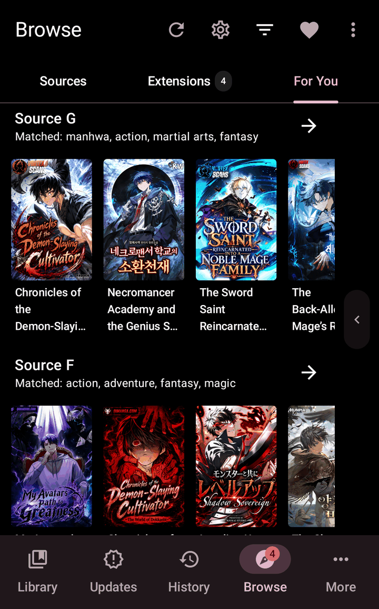
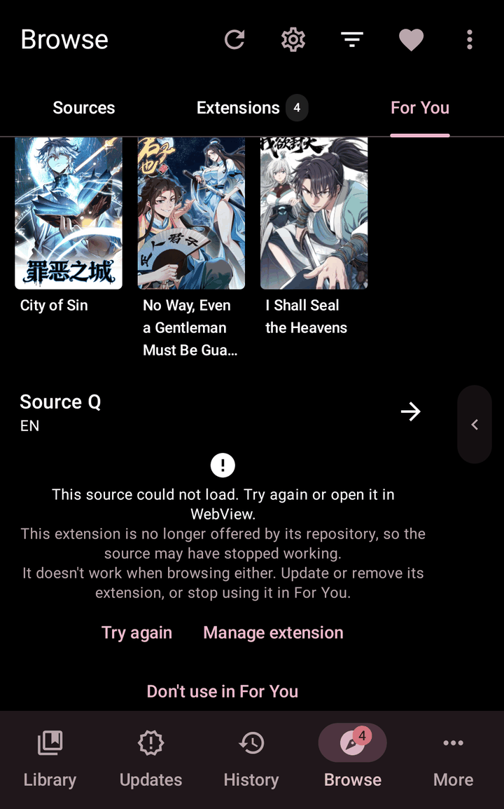
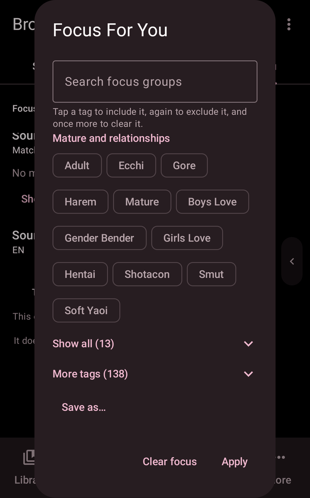
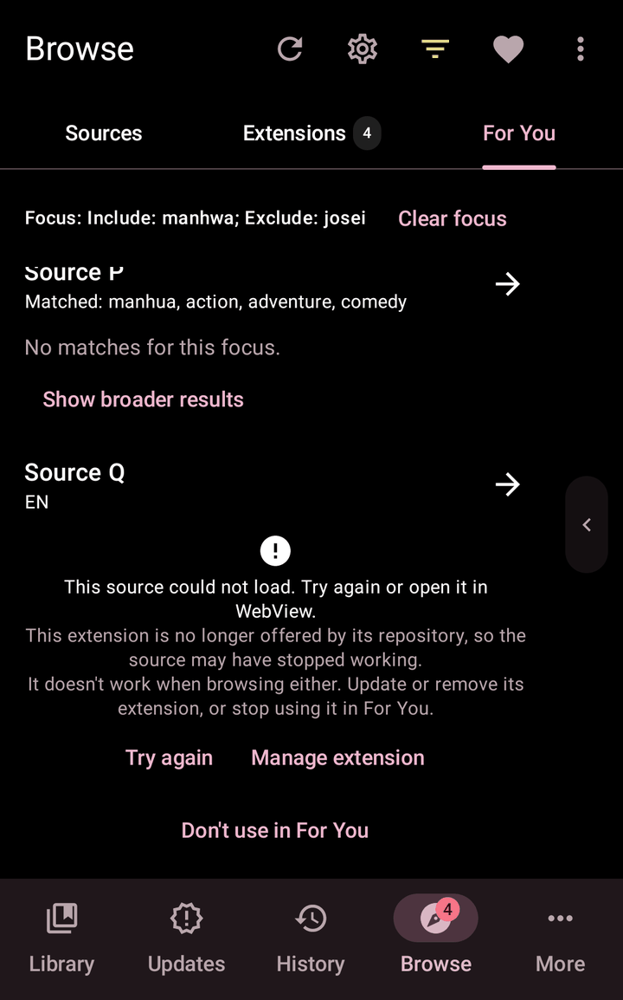

# Personalized recommendations and discovery

For You suggests manga from your chosen installed sources. It combines matches for your taste with newer discoveries and applies your filters. It can also move repeatedly shown manga lower when the app has no recorded interaction with them.

## Where you find it

Open **Browse**, then select **For You**. The page shows topic shortcuts and a **Focus** control. Below them are recommendation rows for the sources that are eligible under the current settings. The page menu also opens [Source evaluation](source-evaluation.md) and [Recommendation Settings](recommendation-settings.md).

<em>For You with name hiding on: each row is one source.</em>

## What For You is designed to do

For You is not a single popularity list. It gathers manga from your chosen sources, applies your filters, and combines matches for your taste with newer discoveries. Personalized results remain the majority when enough are available. Newer discoveries still use your blocked genres, languages, and source rules.

Your taste comes from ratings and preferred and blocked tags. **Use recent reading**, on by default, also boosts tags from manga read within your chosen window. The boost depends on how much and how recently you read; it does not always outweigh an older rating. Your long-term ratings still contribute, and blocked or disliked tags are not boosted.

When repeat rotation is enabled, the page remembers manga shown in recent results. A manga shown more than once within your chosen time window can move lower instead of disappearing. That effect fades as the last showing gets older and ends when it falls outside the window. Manga saved in your library, rated, tracked, or with another recorded interaction are exempt. The app does not treat a lack of interaction as a dislike.

With **Hide manga you already know** on, each refresh filters out titles you have since rated, added to your library, or started reading, including titles remembered from earlier refreshes.

## What you see on the page

- Topic shortcuts provide fast entry points into broad recommendation groups.
- Each source row shows its own results, loading status, or an explanation when results are unavailable.
- A row labelled **Looser matches: its tags don't match your taste** contains looser matches. See [When a source's manga don't match your taste](#when-a-sources-manga-dont-match-your-taste).
- Manga cards keep the normal Komikku interaction model: opening a result leads to its manga page; it does not save a preference without telling you.
- Name hiding can hide source labels in screenshots. It does not change which manga are recommended or hide every personal detail. See [Sharing](sharing.md).

The order can change as new results arrive and previously shown manga move lower. Your filters still apply.

## How a refresh finds manga

For You searches your enabled sources in your chosen order, a few at a time. The next source starts as soon as a search slot is free. Once enough rows are ready, sources still searching are stopped, and they do not leave a loading row behind.

For each source, For You first searches for your taste. If those searches return no manga and did not fail, it tries the source's Popular page. Your filters still apply to those results; this does not guarantee a full row. Empty results are not reused from the cache, so the next refresh searches again.

### When a source's manga don't match your taste

A source can return manga that all fail your taste matching, often because the source tags its manga poorly or not at all. With **Show looser matches** on, which is the default, that source's row shows up to four of those manga, labelled as looser matches, instead of an empty row.

Looser matches still respect your blocked tags, dislikes, ratings, known-manga choices, and minimum chapter count; only the requirement to share a tag with your taste is relaxed. They are picked from what the source already returned in this refresh, so no extra request is made. They stay in their own source's row, never enter Top Picks, and are not a judgement of quality. The source's status still counts the refresh as filtered out. Turn them off under **Recommendation Settings > For You feed**.

### When a source is much slower than the others

A source that takes far longer than the other sources in the same refresh is stopped and shown as an error row with **Try again**. The time limit follows how long your other sources took, and it is always between 30 seconds and 3 minutes. Until the first source finishes, the limit is 3 minutes. On a slow connection every source takes longer, so the limit grows with them instead of cutting sources off at a fixed time.

### When a source fails

A failed row says what probably went wrong and what to try:

| Message | Likely cause |
| --- | --- |
| Check your connection, then try again. | The device could not reach the site, or the connection timed out. |
| The site wants a browser check. Open it once, then try again. | The site asked for a browser check, such as a Cloudflare page. **Open site** opens it in the in-app browser. |
| The site is having problems. Try again later. | The site was overloaded, returned a server error, or was too slow for this refresh. |
| This extension may need an update. | The extension did not work with this version of the app. |
| This source could not load. Try again or open it in WebView. | Any other error. Opening the source in WebView can show what the site is doing. |

<em>Failed rows: the likely cause, extension notes, and the actions that apply.</em>

<em>After Check source: the source does not work when browsing either.</em>

The row offers these actions when they apply:

| Action | When to use it |
| --- | --- |
| Try again | Available on failed rows; searches that source again. |
| Open site | Offered for a browser check. Complete it in the in-app browser, return, then try again. |
| Check source | Offered after failures in most recent refreshes. Tests the source's Popular page once to see whether normal browsing works. |
| Manage extension | Offered when an update is available, the repository no longer offers the extension, or Check source finds it broken. Open its page to update or remove it. |
| Don't use in For You | Offered after repeated failures or a failed Check source. Disables recommendations from it without uninstalling it or hiding it in Browse. Turn it back on under **For You feed**. |

**Check source** distinguishes two situations:

- **It works when browsing.** Only For You's searches fail, so you can stop using the source in For You and keep reading from it.
- **It doesn't work when browsing either.** Update or remove its extension, or stop using it in For You.

A note also appears when the extension has an update available or is no longer offered by its repository, which can mean the source stopped working. For a source that failed in most of its recent refreshes, the row also says how often, for example "This source failed in 17 of its last 17 refreshes".

## Minimum chapter count

**Minimum chapter count** under **Your taste** hides manga with a known count below your choice. A new result's count is usually unknown until its chapter list loads. After showing its rows, For You checks up to 20 displayed titles with unknown counts, a few at a time. Once checked, titles below your minimum are removed. Counts are remembered for two weeks so later refreshes can filter them straight away.

<em>Minimum chapter count under Your taste.</em>

Titles that could not be checked yet stay visible; an unknown count is not treated as zero chapters. The check does not run while For You is saving data.

## Saving data

**Use less data on recommendations** under **Speed and data** can be Automatic, Always, or Never. Automatic saves data on a metered connection, such as a network marked as limited, or one Android reports as slow. Never keeps your normal configured limits; it does not make searches unlimited.

<em>Use less data on recommendations under Speed and data.</em>

While saving data, For You:

- skips the optional extra discovery page and new-release exploration;
- tries fewer search variations per source;
- does not run the minimum chapter check;
- stops once about half the usual number of rows are ready, so sources further down your list may not be searched.

A manga's Recommendations and the library recommendation search look in at most 6 of your sources instead of 20 and fetch fewer details. Your filters are unchanged.

## Focus on what you want now

**Focus** narrows For You to a few tags for the moment without changing your saved taste. Open it and choose tags:

- Tap a tag once to include it, a second time to exclude it, and a third time to clear it.
- **Match All** shows only manga that have every included tag. **Match Any** shows manga that have at least one of them.
- An excluded tag removes every manga that has it, whichever match choice you use.

<em>Manhwa is included (check mark) and Josei is excluded (minus sign).</em>

<em>Tags are grouped by kind, and unrecognized tags are folded under More tags.</em>

<em>An active focus, with Clear focus and Show broader results.</em>

Tags are grouped so the list stays short enough to scan:

1. **Format**, **Demographic**, and **Presentation and access** come first.
2. **Your tags** lists your strongest liked tags and every tag you have selected.
3. **Genres**, **Story and tropes**, **Settings and worlds**, **Characters**, and **Mature and relationships** follow. In each group, tags in what For You is showing now come first. Long groups show their first 12 tags with **Show all**.
4. **More tags**, folded, holds tags the app does not recognize.

Searching shows every matching tag unfolded. The same tag from different sources appears once: numbered copies such as Adventure (157) and Adventure 27 are one Adventure tag. A plural spelling such as Monsters joins Monster when your sources use both.

While a focus is active, **Show broader results** temporarily shows everything again without clearing your choice. **Save as…** stores the selection as a saved Focus mode, which you can rename, reorder, or delete under **Recommendation Settings > Focus modes**.

## Top Picks, selection, and sharing

Top Picks combines the strongest currently available matches into a focused list. The per-source rows stay, so you can still see where broader discovery came from. Looser matches never appear in Top Picks.

<em>Selecting manga in Top Picks to apply a preference.</em>

Use a card's selection action to enter selection mode; on a touch screen, this may be a press-and-hold gesture. The selection bar can apply a preference or clear one across the chosen manga. Single-item actions can open the manga or continue into [version comparison](versions.md).

Top Picks, an individual source row, or a rated collection can also be exported as a recommendation bundle to share. Import opens a review screen first. Check the manga and source matches before adding anything to your library. Entries that cannot be matched or read are identified rather than silently added as another manga. See [Sharing](sharing.md).

## Recommendations from a group

Rated and linked-version groups can start a recommendation search using the whole group rather than one manga alone. Results appear source by source, and the preview-size setting controls how many appear at first. Leaving the page stops unfinished work; a slow or failing source affects its own row rather than the whole result.

<em>Recommendations for a confirmed group arrive source by source.</em>

## One source's row

| Outcome | What the row can show |
| --- | --- |
| Search fails or takes too long | An error hint and **Try again**. |
| Searches return no manga without an error | A Popular-page attempt, still subject to your filters. |
| Eligible manga match your taste | Matching manga. |
| No taste matches, but eligible looser matches exist and are enabled | Up to four looser matches, labelled as such. |
| Nothing is left to show | An explanation instead of invented results. |

Every path still applies your blocked tags, dislikes, ratings, and known-manga choices first.

## Which manga can appear

Before ranking, a manga must pass your language, source, rating, known-manga, and blocked-tag choices. With a minimum chapter count enabled:

- A known count below the minimum hides the manga.
- An unknown count can remain visible. Up to 20 displayed titles can be checked later, unless data saving is active.
- Passing the filters does not guarantee a visible place; result limits still apply.

These are **For You** rules, not a promise about every recommendation search. Newer discoveries use the same For You filters.

## Why repeated cards can move lower

With repeat rotation enabled:

Moving a manga lower changes its position only. It does not delete the manga or remove your library entry, rating, or tracking.

The page keeps personalized results, looser matches, recent discoveries, filters, and source status separate so the result remains understandable and predictable.
