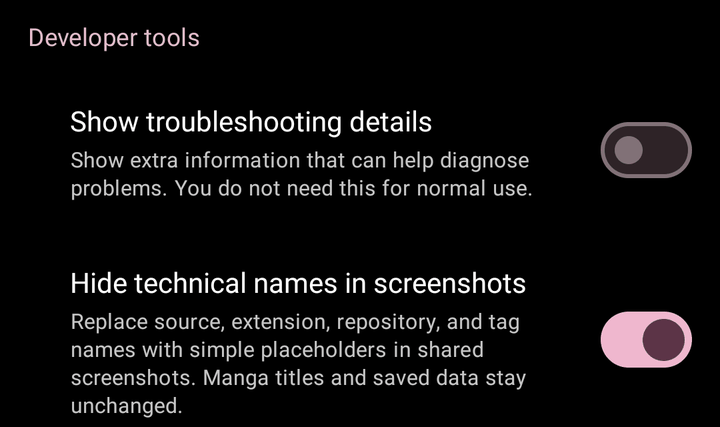

# Sharing screenshots and files safely

You can share recommendation lists, export installed extensions, or take screenshots. Check what each contains before sending it to someone else.

## Hide labels in screenshots

Open **Settings > Advanced** and, under **Developer tools**, turn on **Hide technical names in screenshots**. This guide calls it name hiding. Supported source, extension, repository, and preference-tag labels become neutral labels. These labels can change after restarting the app.

<em>Settings, Advanced, Developer tools: Hide technical names in screenshots.</em>

This changes supported screen labels and the suggested filename for For You source exports, not saved data or file contents. Manga titles, artwork, reader pages, ratings, history, account names, notifications, and Android controls are not hidden automatically. **The download queue can still show source names even with name hiding on.**

Before taking a screenshot, check the whole screen and cover or crop anything you do not want to share.

## Share a recommendation list

1. Use the export action in **For You** or **Top Picks**.
2. Choose where to save the file in Android's document picker. Cancelling before choosing a destination does not create an export file through this action.
3. Read the result, then check the completed file before sharing it. A failed or uncertain result needs checking before you retry.

Someone importing the file sees a review screen. Opening it alone does not add its manga to their library.

<em>Exporting Top Picks as a recommendation bundle.</em>

**Name hiding does not hide information inside exported files.** Recommendation files can contain real manga titles and links, source and extension names, repository names, cover links, descriptions, genres, recommendation scores, and the preference groups that matched. These details can reveal your reading interests, even without account information.

An extension export contains the selected installed extension package, or an archive of selected packages. It is not a backup of your library, ratings, reading history, or tracker accounts. Share only extensions you trust and have permission to distribute.

## If an export fails

A successful export is kept at the location you chose. Normal exports do not offer to remove a successfully saved file.

Android can create the destination file before the export finishes. If the app knows that the write failed, was interrupted, or left an incomplete file, it can offer **Keep** or **Remove** for that file. Remove targets only the file created by this export, not older files with similar names or other files in the folder.

If the app cannot confirm whether the export finished, it leaves the file as it is and explains that the result is unknown. Check it yourself before sharing or retrying. If removal fails, the file remains; you can retry removal or keep it.

**Keep** leaves the file in place. **Remove** attempts to delete that identified file only. See [Incomplete exports](safety.md#incomplete-exports) for the removal steps and limits.

## Check before sending

For screenshots, inspect the whole image, including the status bar and notifications. Crop or cover information you do not want to share. For exported files, check their contents separately: neutral screen labels do not make the files anonymous.

| Sharing | Check first |
| --- | --- |
| Screenshot | Manga titles and artwork, page text, ratings, accounts, reading history, notifications, and any source names still visible. |
| Exported file | Real names, links, and reading-interest details inside the file, not just its name or the screen used to create it. |

If you cannot remove details you want to keep private, do not send the image or file. Send checked material only to your intended recipient.

Name hiding is a screenshot aid, not a privacy guarantee. Check each image or file yourself.
