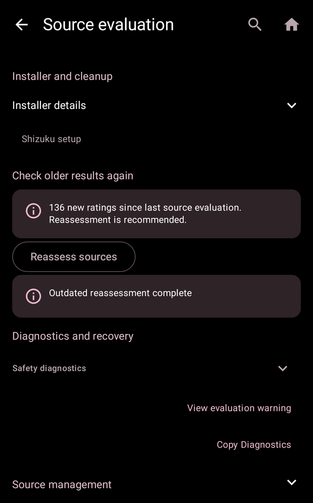
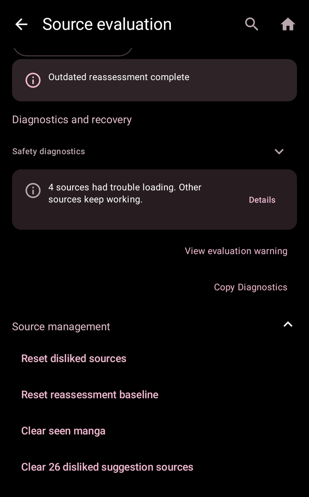

# Evaluating recommendation source quality

Source evaluation helps you decide which manga sources are worth using for recommendations. It checks a sample of manga and saves a result with a short explanation. A source is a manga website or service accessed through an extension. Some checks temporarily install an extension, then try to remove it, so read the installation and cleanup warning before starting.

## Where you find it

You can open Source evaluation from four places:

- **Recommendation Settings > Source evaluation**;
- **Recommendation Settings > Find new sources > Source evaluation**;
- the For You menu;
- the **Sources with problems** row under **Recommendation Settings > Troubleshooting**.

<em>Run options, Start, and the reason Start is unavailable.</em>

The page is laid out in this order:

1. Readiness and progress.
2. Run options and the **Start** or **Continue** button.
3. Past results, directly below the buttons.
4. Installer settings.
5. Reassessment.
6. Quality results.
7. **Diagnostics and recovery**, and **Management**, at the end.

When **Start** cannot be used, a line under it says why:

| Message | What to do |
| --- | --- |
| Start is unavailable until an extension installer is ready. See Installer below. | Set up the installer in the Installer section. |
| Nothing to evaluate yet: every available source already has a result. | Use reassessment under **Check older results again**, or install more sources. |
| No extension list is available yet. Check your extension repositories in Browse. | Add or refresh an extension repository. |
| No available source matches your languages and content settings. Check Languages on Your taste. | Change the recommendation languages or content options. |

## What an evaluation means

An evaluation samples a source's popular and recent manga and compares their available details with your preferences. Search compatibility is checked separately. It is not a permanent judgment about the source, a complete inspection of its catalogue, or a promise about how many recommendations you will see.

## Before starting a check

1. Under **Sources to check at once**, choose 10, 25, 50, or 100. This is the maximum number of sources checked before the app pauses for you to select **Continue**. For a short first check, choose 10.
2. Open **More setup options** if you want to change which sources are checked:
   - **Skip already-evaluated sources** leaves sources with saved results out of this check. To update old results, use **Check older results again** below.
   - **Include explicit/hentai candidates** lets this check consider sources marked as sexually explicit, even if your usual explicit-content filter excludes them. Leave it off to follow that filter. This option does not change what For You is allowed to show.
3. Review **Installer and cleanup**. Follow any setup instructions or warning before selecting **Start**.

The installer chosen here applies only to source evaluation, not ordinary extension installation. Some methods need Android confirmation prompts or extra setup. If **Start** is unavailable, follow the reason shown beneath it.

Read the warning before confirming. A check may install an extension, contact its source, and then try to uninstall the extension. Removal may need your confirmation or fail; check any message about extensions left installed. Wait for this check to finish before starting another extension check.

The saved result shows how well the source fits, how much information supports that result, when it was checked, and a short explanation. A source providing too little information needs your review; that alone does not mean its manga are a poor match.

## Reassess results

An old result can stop describing the source well when your taste or the extension changes. The **Check older results again** section offers the actions that apply:

| Action | When it appears | What it does |
| --- | --- | --- |
| Reassess sources, or Reassess using current tastes | Saved results exist. The label is **Reassess sources**, with a note that reassessment is recommended, once you have added many ratings since the last check. | Checks already evaluated sources again against your current taste. |
| Reassess updated extensions | Extensions you evaluated have been updated since their result. | Checks only those updated extensions again. |
| Reassess outdated (number of sources) | Some saved results no longer match your current settings or installed extensions. | Checks the outdated sources that the current run can process, and says how many were left out and why. **Continue reassessing outdated** resumes it. |

<em>Reassessment is recommended after many new ratings.</em>

Reassessment uses the same installer, warnings, and cleanup as a normal check.

## Automatic check

**Recommendation Settings > Find new sources > Automatic check** can re-check your sources on a schedule. It is off until you turn it on. Once on, it re-checks only sources whose result is missing or out of date, every 7, 14, or 30 days, or a custom number of days from 1 to 90.

<em>The automatic check settings are under Find new sources.</em>

By default it waits for Wi-Fi and for the battery not to be low. These requirements apply for the whole check, not only when it starts. If they stop being met, the check stops, and a later scheduled check picks up the sources that are still out of date. Turning **Check automatically** off also stops a check it has already started. The automatic check never installs or removes a source and never changes your source order. A check you start yourself on this page is not affected by these settings.

With **Use results on For You** on, For You skips a source only when two things are both true:

- its latest check found no usable picks;
- For You has shown nothing from it in at least three recent refreshes.

**Recommendation Settings > Troubleshooting** lists sources skipped by this setting. Turn **Use results on For You** off to stop this automatic skipping. Your other source choices and content filters still apply. If skipping would leave no sources at all, the app keeps them available.

## Progress and result states

| State | Meaning | Available action |
| --- | --- | --- |
| Ready | Available sources have not yet been checked with these settings. | Start a check. |
| Running | The app is checking sources and saving progress. | You can leave the page or cancel. |
| Cancelling | The app is stopping the check. | Wait before starting another check. |
| Completed | The selected sources have been checked. | Check again if your preferences or sources change. |
| Cancelled | You stopped before all selected sources were checked. | Review the results and continue any remaining checks. |
| Failed | The operation itself could not continue. | Retry after the stated condition changes. |
| Connectivity lost | The queue stopped because the required connection was lost. | Restore the connection, then use the retry action shown by the screen. |
| No actionable work | The queue had no source it could process with the current inputs. | Review the setup and available sources before starting again. |

Leaving the page does not mark unchecked sources as complete. **Continue** uses saved progress if your settings and installed extensions still match that check.

## Why Great fit can show only a few manga

The source-fit badge summarizes earlier For You refreshes. **Great fit** means the source has often supplied useful matches; it is not a promise that every refresh will show the same number of manga.

The Top Picks count records how often the source contributed to that row. The current **Shown** count reports matches visible after the latest refresh, including your filters and duplicate handling. These counts measure different things. A source can have a strong history and show only one match today.

If too few manga appear, check your minimum chapter count, blocked tags, languages, and other recommendation filters. Compare the source's current explanation with its history before excluding it. See [Recommendation settings](recommendation-settings.md).

## Taste and source-quality diagnostics

**Recommendation Settings > Troubleshooting** also shows your rating counts, suggestions based on repeated ratings, how much manga information a source provides, and its past results. A suggestion needs support from more than one rated manga; one rating does not automatically create a rule for an entire genre.

<em>Source quality information for one source.</em>

Source-quality marks describe the source's collection, not your opinion of one manga. Use source actions to change those marks; see [Sources](sources.md) for their location and effects. Showing quality-marked results on the evaluation page does not remove the marks. These choices are separate from rating manga. The check is not a security audit or a guarantee that an extension is safe to install.

## Show and sort past results

Use the past-results controls to show or hide installed sources and sources with quality marks. Showing a hidden result does not clear its quality mark, install an extension, or enable recommendations from it.

Sort by Best fit, Newest, Source name, Extension name, For You compatibility, or Explicit risk. Sorting changes the list order; it does not run another evaluation or change a saved result.

**Clear all** beside past results asks for confirmation before clearing saved Source evaluation results. It does not uninstall the extensions. Check the outcome before assuming the clear succeeded.

## Understand the management resets

Expand **Source management** to find these actions. Each requests confirmation. Cancel the confirmation if you want to keep the saved information.

| Action | What it clears or resets |
| --- | --- |
| Reset disliked sources | Clears saved recommendation dislikes for sources. Other filters, quality marks, and disabled-source choices can still exclude them. |
| Reset reassessment baseline | Resets the remembered rating count and time used to suggest reassessment. It does not erase your manga ratings or perform a new evaluation. |
| Clear seen manga | Clears manga marked Not interested. Despite the label, this is not a reset of chapter read marks or general reading history. Check those manga's ratings afterwards if the operation was interrupted. |
| Clear dismissed suggestions | Makes dismissed Sources to Try suggestions eligible again when their other conditions allow them. It does not install them. |
| Clear disliked suggestion sources | Clears the same saved source-dislike list used by Reset disliked sources, including dislikes that can affect installed-source recommendations. It does not clear quality marks or dismissals. |

Some actions appear only when there is information to clear. None of these actions repairs an unavailable source or guarantees that new recommendations will appear. For the separate discovery-history reset and its scope, see [Recommendation settings](recommendation-settings.md).

## Diagnostics and recovery

When no evaluation job is active, open **Diagnostics and recovery**. **View warning** shows the installation and cleanup warning again without starting a check.

<em>A source-loading warning with Details, followed by Source management.</em>

**Copy Diagnostics** puts a short report on your clipboard; it does not send it anywhere. The report includes the app version, time, evaluation options, counts, current job stage, and Shizuku setup status. Source and extension names can appear when name hiding is off. Name hiding replaces those names with generic labels. This report uses error categories rather than raw errors and does not include extension package names or signature hashes. Read the copied text before sharing it; this does not describe the contents of other logs or screenshots.

If a source-loading warning appears in this section, open **Details**. Sources that failed to load are also listed under **Recommendation Settings > Troubleshooting > Sources with problems**, which opens this page. The available actions depend on the problem:

| Action | What it does |
| --- | --- |
| Retry | Forgets the temporary failure recorded for this source so the next request can try again. It does not update or repair the extension. |
| Update | Requests an available update for an installed extension. Follow any Android installation prompts and check the outcome. |
| Reinstall | Requests installation of the extension version currently available. This is not a promise that the failure will be fixed. |
| Uninstall | Requests removal of the installed extension. Check Extensions afterwards to confirm removal. |
| Disable | Asks for confirmation before saving a block against loading that extension again. It does not uninstall it or remove your manga. |

Not every problem offers every action. Retry does not remove the separate saved safety restrictions described below.

## Quarantined and blocked extensions

Expand **Safety diagnostics** when it appears, then select the quarantined or blocked count to see its list. These lists describe different restrictions:

- **Quarantined Extensions** were set aside after a suspected fatal crash during evaluation. Future evaluations skip them, but quarantine does not uninstall them or prevent their use elsewhere in the app. Remove a crashing installed extension from Extensions rather than assuming this list protects ordinary browsing and reading.
- **Blocked Extensions** have a saved restriction against loading their code in the app. An installed extension remains installed until you uninstall it from Extensions or Android Settings.

In the quarantined list, **Remove** clears one saved quarantine entry; it does not uninstall the extension. **Clear quarantine** asks for confirmation before clearing the saved quarantine list. Only retry a previously crashing extension if you have reason to believe the problem has changed.

In the blocked list, **Allow again** appears for entries that can be removed. It clears that extension's saved load restriction. **Allow all** asks for confirmation before clearing saved load restrictions. Neither action installs an extension, removes evaluation quarantine, or proves that an extension is now safe. Restrictions built into the app are separate and cannot be removed by clearing these saved lists. A newer-version notice is a reason to investigate an update, not proof that the crash has been fixed.

Check the lists after a clear or allow action. If a previously crashing extension is still installed, allowing it again can cause another crash. Cancel a confirmation to keep the restrictions.

## Evaluation overview

After each group, select **Continue** if more sources are waiting. You can leave the page while a check runs, but closing the app or restarting the device may interrupt it.

## Read one source's result

Catalogue quality and recommendation-search compatibility are separate signals. A source can succeed at one and fail at the other.

## Continue or reassess

If you change settings or extensions, the app starts a fresh check rather than mixing results from different setups.

## Failure isolation

A problem with one source does not necessarily stop the others. Cancelling never marks unchecked sources as completed.

## From checks to a result

Catalogue fit and search compatibility answer different questions. A source can offer manga you like even when its searches are unreliable. Neither result guarantees that every manga will appear after your current filters are applied.
