# Troubleshooting sources and reading

Start with the action that failed and the message on that page. A source is the website or service used by an extension. One source may fail while another still works; this does not mean your library is lost.

## A source cannot load

Check your connection, then check whether the source's website is available. If an extension update is available, read its details before updating. Retry the failed action when the page offers it.

If it still fails, try another source or report the problem with the steps below.

The app temporarily avoids repeated calls to a recently failed source. This does not uninstall or permanently disable the extension. A retry can still fail if the underlying problem has not changed.

Source evaluation has a separate restriction for extensions associated with a detected crash during evaluation. A normal connection failure and an evaluation crash restriction are not the same thing. Follow the message on the evaluation page rather than repeatedly forcing the source to run.

## For You shows few or no manga

1. Open **Recommendation Settings > For You feed** and check enabled sources.
2. In **Your taste**, check recommendation languages, tag filters, and minimum chapter count.
3. Read each source row's message, then refresh For You after changing a setting.
4. If results are still missing, use **Check source** when offered or open [Source evaluation](source-evaluation.md).

<em>Check which sources are enabled under For You feed.</em>

A strong source-fit rating does not guarantee many visible recommendations. Fit describes the source's usefulness; shown results also depend on your manga filters and what the source returned.

An empty list does not prove the source has no manga. If its searches return no manga without an error, For You tries its Popular page, still using your filters. If manga return but none share a tag with your taste, **Show looser matches** under **For You feed** can show a few eligible ones instead of an empty row.

**Recommendation Settings > Troubleshooting** lists sources that failed to load, and any sources the automatic check is skipping on For You. See [Recommendations](recommendations.md), [Recommendation settings](recommendation-settings.md), and [Sources](sources.md) for the controls that affect this list.

In Sources to Try, clear a search that finds nothing before changing your settings. Also check dismissed suggestions, dislikes, content filters, languages, and repository availability.

## A For You source keeps failing

Read the message on the failed row first. It names the likely cause: your connection, a browser check the site wants, a problem on the site, or an extension that may need an update.

<em>A row that keeps failing offers Check source and Don't use in For You.</em>

A source that takes too long ends as an error row with **Try again**. The limit adapts to other sources in that refresh, between 30 seconds and 3 minutes. It can still time out on a slow connection; it is not an unlimited wait.

**Don't use in For You** affects recommendations only; it does not uninstall the extension. Turn the source back on under **For You feed**.

## A large download stops partway

An ordinary image or page-list failure does not automatically suppress every later download from that source. Check the failed chapter's message in the download queue and retry it when appropriate. A broken or incompatible extension can still hold back reading and downloading; it may need an update or replacement. See [Extensions](extensions.md).

## Preview or reader pages fail

In **Find Best Version**, use **Retry** when a preview fails. **View in Reader** provides another way to open the selected chapter even if preview images failed; it still needs the chapter to be available. Press Back to return to the comparison page.

<em>Preview samples in an older capture; current builds also offer Retry and View in Reader.</em>

If the chapter cannot load in the reader either, check the source or another linked version before retrying the preview.

A working preview does not guarantee that every chapter will load, and View in Reader cannot repair a missing chapter or unavailable source. Reading there can update normal reading progress.

If alternate-source switching cannot find the matching chapter, check the chapter list and its scanlator or release-group labels. Choose the appropriate chapter instead of assuming different sources number every chapter identically. See [Reading](reading.md) and [Compare versions](versions.md).

For downloaded-page text searches, check that the pages are still downloaded and process those pages again if old results no longer open. See [Search downloaded pages](ocr.md).

## The app closes or an action stops partway through

A recoverable source error may leave other results available, but not every crash can be caught. If the app closes, reopen it and inspect the current state before repeating a restore, migration, or bulk installation. Some work may already have completed.

| Interrupted action | Check before continuing |
| --- | --- |
| Reading | Current chapter and tracker progress. |
| Restore or migration | Which items returned or moved, and any reported failures. |
| Bulk installation | Which extensions actually installed. |
| App keeps closing | Record the app version and the steps that reproduce it. |

For a repeatable problem, include the app version from **More > About > Version**, the steps taken, the expected result, and what happened. A screenshot or crash log can help, but a crash report may not be available for every closure.

Check screenshots and logs before sharing: logs can contain source names and technical details, and screenshots can expose manga titles or account information. Name hiding does not anonymize everything. See [Sharing](sharing.md) and the repository's [issue tracker](https://github.com/FancyCorey/komikku-fc/issues).

For interrupted restores and supported Undo actions, see [Backups](backups.md) and [Links, Undo, and file safety](safety.md). Cancellation is not a promise that all completed work was reversed.
