# Finding and comparing manga versions

Find the same manga on other sources, confirm the correct matches, and compare their chapters and pages. Looking at another version does not move your library entry; migration needs a separate confirmation.

## Where you find it

Open a manga and choose **Find other versions** from its actions. Confirm which results are the same manga. **Find Best Version** lets you compare their chapters and pages before choosing whether to replace your library entry.

Find Best Version searches sources available to global search, using your enabled-language and disabled-source settings, and honors your **Results per source** limit. Previously confirmed versions start selected; your title-matching default applies to other results. Your preview sample size and **Avoid first pages in preview** setting control automatic page samples. You can change every selection before confirming the comparison.

## What the workflow helps you decide

The matching screen answers “are these the same manga?” The Best Version screen answers “which confirmed version is more useful to me?” Keeping those questions separate prevents a search result from becoming trusted merely because its title looks similar. The reader can inspect candidates, reject mismatches, compare chapter samples, retry an individual preview, and keep the current version without starting migration.

| Action | What it changes |
| --- | --- |
| Find other versions | Select and confirm genuine matches to save their links. Your library entry stays where it is. |
| Choose chapters | Pick samples covering the same part of the story. Only the comparison changes. |
| Review previews | Compare pages; each source's temporary preview can succeed or fail separately. |
| Keep current version | End the comparison without migrating. |
| Select as best version | Review **Migrate**, **Copy**, or **Cancel**. Migrate replaces the current library entry; Copy keeps it too; Cancel applies neither library change. |

## What the comparison looks like

<em>Chapter selection: choose comparable chapters from each version.</em>

<em>Preview comparison: sample pages from each version side by side.</em>

With name hiding enabled, source names appear as neutral labels. Chapter choices and page previews work the same way.

These are older captures and do not show **View in Reader**, which current builds offer on the comparison cards.

## Read a chapter before choosing

Choose **View in Reader** on the current version or another version to open its selected chapter in the full reader. This action is available even when the small previews fail. You can check text size, image clarity, page order, and scrolling using your usual reader controls.

Press **Back** to return to the comparison screen. Opening the reader does not select a best version or start migration. It is ordinary reading, so reading a chapter can update your saved reading progress.

If a candidate's chapter list cannot be loaded, use **Retry** for the failed candidates; successful and unavailable candidates keep their own results. If a chapter cannot be found, choose a chapter from that candidate's own list. A failed thumbnail alone does not mean that the full reader will fail.

## Matching and comparison overview

Find matches, confirm which ones belong together, then compare chapters and pages. Only choose another version if you want to continue to migration or copying. Confirm matches yourself; a similar title is not enough.

## Prepare comparable versions

1. Search from your current manga and select the correct versions.
2. Wait for their chapter lists, then choose samples covering the same part of the story.
3. Read any unavailable or failure message. Choose another chapter, or retry a failed list when offered.

A missing chapter or preview is displayed as unavailable; it is not treated as a failed migration.

Automatic chapter matching helps you find a starting point; it does not guarantee that two translations divide the story into the same chapters. When numbering or availability differs, choose a chapter that covers the same part of the story. A failure from one source does not stop you comparing the others.

## Check pages or open the reader

Compare loaded previews or open them full screen. Use **Retry** for a failed preview, or **View in Reader** to inspect the full chapter. If the chapter cannot open there either, read the message and choose another chapter or source. Press Back to return to comparison; see [Read a chapter before choosing](#read-a-chapter-before-choosing).

Each linked version tracks its own preview. If one preview fails, the other comparisons remain visible.

## Migration result

Confirming a Best Version adds it to the confirmed group. It also receives the group's rating when it is locally tracked and **Rate linked versions together** is on, without replacing a rating you set yourself; see [Ratings](ratings.md#rate-a-whole-group-at-once).

**Keep current version** finishes the comparison without starting migration. Selecting another version opens a confirmation: **Migrate** replaces your current entry, **Copy** keeps the current entry as well, and **Cancel** returns without applying either choice. Read the warning before proceeding: migration cannot be automatically undone and can affect downloaded chapters or connected tracker accounts.

When you confirm **Migrate** or **Copy**, the confirmed relationship is saved before migration starts. A later migration failure does not undo that link.

If a step fails, check the result before trying again. Some changes may already have finished; failure does not mean everything was put back as it was.

## Data, privacy, and recovery

Back up your library before replacing entries. Supported backups can include the links between versions and your preferred version for a linked group. Small page previews are not downloaded chapters for offline reading. Name hiding replaces source names on screen without changing which manga you compare or choose. A backup cannot undo changes made to a connected tracker account.

Komikku FC handles finding, linking, and comparing versions. If you choose another version, Komikku then takes you through its normal library-migration steps.
