# How Komikku FC works

Komikku FC uses your reading choices to help you find manga, compare sources, and keep track of progress. This page explains how those tools fit together. For instructions, use the [user guide](user-guide.md) or [feature guides](feature-guides/README.md). Contributors can use the [feature and code map](feature-and-code-map.md).

## What the app uses

Komikku FC builds on Komikku's library, reader, downloads, tracking, backups, and extension support.

- **On your device:** your library, reading history, ratings, preferences, local tracking, and OCR text index.
- **Online:** installed extensions contact manga sources to browse, search, and load chapters. Connected external trackers contact their own services.
- **Through Android:** permissions, storage access, and the file chooser used for exports and backups.

Komikku FC does not add a separate recommendation account or server. Local tools can use saved data, but online searches still need a working source and connection.

## How For You finds manga

For You can show saved results when you return to the page. Refreshing asks sources for new results, using your preferences, recent reading, and previously shown manga.

The app favors matches to your taste when enough are available. New releases can add variety, but still pass through your filters. A title with an unknown chapter count may appear even when you set a minimum. Each row also has a result limit, so passing the filters does not guarantee a place.

**Wait before showing a title again** moves recently repeated suggestions lower in the list. This changes their order, not your library or reading progress. Manga you have interacted with—such as by rating or tracking them—can be exempt when that information is available. See [Recommendations](feature-guides/recommendations.md).

## Ratings can change

Choose **Love**, **Like**, **Dislike**, or **Not interested**. You can choose another rating or clear it later. Each rating has a marker and collection.

Some successful changes offer **Undo** in **Action History**. Undo can restore the previous value if the current value still matches. It cannot undo every action, and it does not replace a backup. See [Ratings](feature-guides/ratings.md).

## Reading, schedules, and rating prompts

The reading schedule is optional and off by default. The reader checks it when opening and returning to the foreground. If restricted hours begin while you are reading, the grace message explains whether you may finish the current chapter. Changing chapters does not bypass the restriction. The manual reading timer is separate.

After you finish the latest available chapter, the app can offer a rating when you leave the reader. This needs **Ask for a rating after finishing**, an unrated manga, and a normal reader session without an active alternate-source session. No offer appears if the schedule blocks the session at completion.

**Ask about other versions** controls the separate follow-up after a rating. Cancelling that search offer keeps the rating you already saved. See [Reading](feature-guides/reading.md).

## Switching sources and sharing progress

Within an active source pair, **Switch source** lets you move in either direction. Chapter suggestions use chapter numbers or the closest available number; check the contents yourself because matching numbers do not guarantee matching pages.

Local Tracking applies saved progress when a manga opens or refreshes. It can share progress with confirmed versions that participate in tracking. Switching a reading source and sharing tracked progress are separate actions. See [Local tracking](feature-guides/local-tracking.md).

## When work stops

One source failing does not necessarily erase useful results from another. Some extension crashes can still stop the app.

Cancelling stops pending work where supported. It does not reverse an extension already installed, a file already exported, or an update already sent to an external tracker. Check the result before retrying or assuming nothing changed.

## Privacy and backups

- **Name hiding** replaces supported labels on screen. It does not change saved identifiers, requests, or exported file contents. Titles, artwork, reading context, tag suggestions, and counts can remain visible. Inspect the whole screen or file before sharing it.
- **OCR text** is kept locally and can be rebuilt from downloaded pages. It is excluded from backup and sync. Clearing the text index does not delete the pages.
- **Backups** can include ratings, settings, linked versions, and local tracking when you select their separate options. Sensitive settings are optional; protect any backup you share.

See [Privacy and data](privacy-and-data.md) and [Backups](feature-guides/backups.md).
